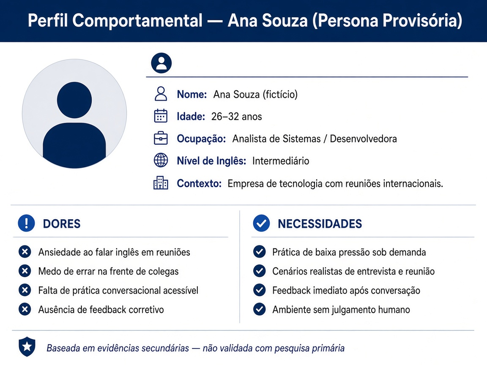
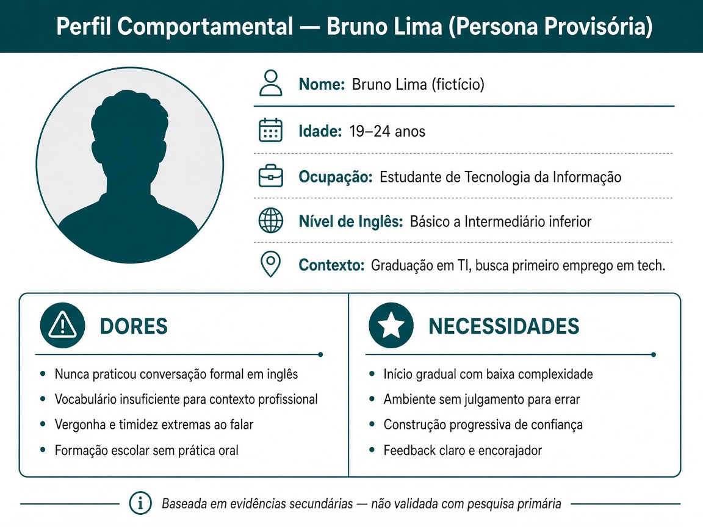

# Personas — Fase 3: Persona, Empatia e Observação

**Projeto:** Desafio e Solução — Simulador de Conversação em Inglês com IA
**Curso:** Pós-Graduação em Arquitetura de Software e Soluções com IA
**Agente responsável:** Persona & Empathy Specialist
**Data:** 25 de outubro de 2026
**Versão:** 1.1 (atualizada com curso — UA-01)

> ⚠️ **Aviso de integridade acadêmica:** Ambas as personas a seguir são **provisórias — baseadas em hipóteses e evidências secundárias**. Nenhuma entrevista, questionário ou observação direta com usuários reais foi conduzida. Os traços de cada persona foram **inferidos** a partir da literatura revisada na Fase 2 (`deliverables/phase-2/context-report.md`). Cada inferência está identificada com a respectiva tag (`[FONTE-SECUNDÁRIA]`, `[INFERÊNCIA]`, `[ASSUMPTION — requires validation]`).

---

## 1. Persona Principal — Ana Souza *(nome fictício)*

### 1.1 Perfil Comportamental

**Figura 1 — Perfil Comportamental Ana Souza**

| Campo | Descrição | Tipo |
|-------|-----------|------|
| **Nome** | Ana Souza *(fictício — identificado explicitamente)* | — |
| **Idade** | 26 a 32 anos | `[INFERÊNCIA]` baseada na faixa etária de profissionais de nível júnior/pleno no mercado de TI brasileiro |
| **Ocupação** | Analista de sistemas ou desenvolvedora em empresa de tecnologia | `[INFERÊNCIA]` — perfil inferido a partir da pesquisa Pearson (2024): 85% associam inglês a sucesso profissional; demanda de mercado percebida por fornecedores de IA (ELSA Speak, 2026) confirma módulos para entrevistas e reuniões |
| **Nível de inglês** | Intermediário (lê e entende razoavelmente; fala com hesitação e ansiedade) | `[INFERÊNCIA]` compatível com o padrão nacional: EF EPI 2025 posiciona Brasil na 75ª posição global; fala é a habilidade mais fraca (464 pontos) `[FONTE-SECUNDÁRIA]` (EF EDUCATION FIRST, 2025) |
| **Contexto de uso do inglês** | Reuniões com equipes internacionais, entrevistas de emprego em empresas tech multinacionais, comunicação por e-mail | `[INFERÊNCIA]` compatível com as lacunas de mercado identificadas na Seção 4 do context-report.md |
| **Ferramentas usadas hoje** | Duolingo (vocabulário), YouTube (compreensão auditiva passiva), raramente aplicativos focados em fala | `[ASSUMPTION — requires validation]` — não há dado primário disponível |
| **Frequência de prática oral** | Esporádica (menos de 2 vezes por semana) | `[INFERÊNCIA]` baseada em: 46% dos respondentes da pesquisa Pearson relataram falta de oportunidades de treino de conversação; 50% não encontraram ambientes de prática fora da escola `[FONTE-SECUNDÁRIA]` (DIRETTRIX, 2024; PORVIR, 2024) |

### 1.2 Situações de Uso

| Situação | Frequência relatada na literatura | Tipo de evidência |
|----------|----------------------------------|-------------------|
| Entrevistas de emprego em inglês | Demanda percebida confirmada por fornecedores comerciais (ELSA Speak: "Interview Coach") | `[FONTE-SECUNDÁRIA]` (ELSA SPEAK, 2026) |
| Reuniões internacionais / apresentações | Demanda de mercado confirmada (ELSA Speak: "Meeting Coach", "Presentation Coach") | `[FONTE-SECUNDÁRIA]` (ELSA SPEAK, 2026) |
| Conversas informais com colegas estrangeiros | `[ASSUMPTION — requires validation]` — inferida como situação comum no perfil profissional de TI | `[ASSUMPTION]` |
| Viagem a trabalho | Nenhuma fonte acadêmica ou de mercado específica foi localizada — lacuna explícita | `[LACUNA DE EVIDÊNCIA]` (B-03) |

### 1.3 Dores

| Dor | Evidência ou inferência |
|-----|------------------------|
| Ansiedade ao falar em inglês — medo de cometer erros na frente de colegas ou entrevistadores | `[FONTE-SECUNDÁRIA]` — revisão sistemática de 19 estudos identifica ansiedade como barreira mais frequente à fala em EFL (DEWITT; MOOSAVI, 2022); modelo WTC descreve decisão de falar como voluntária e sensível à ansiedade situacional (MACINTYRE et al., 1998) |
| Falta de oportunidades de prática de conversação estruturada | `[FONTE-SECUNDÁRIA]` — 46% sem treino de conversação suficiente em sala; 50% sem ambiente de prática fora da escola (DIRETTRIX, 2024; PORVIR, 2024) |
| Pronúncia percebida como barreira — receio de não ser entendida | `[FONTE-SECUNDÁRIA]` — pronúncia apontada como barreira linguística (SERAJ; HABIL, 2021); viés de ASR contra falantes não nativos (JEON; LEE; CORONEL-MOLINA, 2024) |
| Ausência de feedback corretivo após práticas informais | `[FONTE-SECUNDÁRIA]` — falta de retroalimentação corretiva explícita documentada nas limitações de chatbots (KOÇ; SAVAŞ, 2024) |
| Custo elevado de tutoria humana ao vivo | `[FONTE-SECUNDÁRIA]` — Cambly: custo elevado para uso diário identificado como limitação (WIFITALENTS, 2026) |

### 1.4 Necessidades e Ganhos Desejados

| Necessidade | Tipo |
|-------------|------|
| Praticar conversação em cenários realistas de trabalho (entrevistas, reuniões, apresentações) | `[INFERÊNCIA]` baseada nas situações de uso e dores acima |
| Receber feedback imediato após cada frase ou trecho de conversa | `[INFERÊNCIA]` — falta de retroalimentação é lacuna documentada nas ferramentas existentes |
| Ambiente de baixa pressão — sem julgamento humano imediato — para reduzir ansiedade | `[FONTE-SECUNDÁRIA]` — intervenções de baixa pressão reduzem ansiedade de fala (ÖLMEZER-ÖZTÜRK; ÖZTÜRK, 2021; TABUCHI et al., 2024) |
| Flexibilidade de horário — praticar quando e onde quiser | `[INFERÊNCIA]` baseada no perfil de profissional com agenda variável |
| Progresso visível ao longo do tempo | `[ASSUMPTION — requires validation]` |

---

## 2. Persona Secundária — Bruno Lima *(nome fictício)*

### 2.1 Perfil Comportamental

**Figura 3 — Perfil Comportamental Bruno Lima**

| Campo | Descrição | Tipo |
|-------|-----------|------|
| **Nome** | Bruno Lima *(fictício — identificado explicitamente)* | — |
| **Idade** | 19 a 24 anos | `[INFERÊNCIA]` — perfil de estudante universitário ou recém-formado |
| **Ocupação** | Estudante de graduação em tecnologia da informação ou ciência da computação | `[INFERÊNCIA]` compatível com o perfil de usuário de aplicativos de idiomas descrito na literatura |
| **Nível de inglês** | Básico a intermediário inferior (lê com dicionário; raramente praticou conversação) | `[FONTE-SECUNDÁRIA]` — 70% dos alunos do ensino médio/técnico pesquisados nunca realizaram prova oral em inglês na escola (CORRÊA, 2017); estimativa de que apenas 3% da população brasileira fala inglês (BATISTA, 2020) |
| **Contexto de uso desejado do inglês** | Entrevistas de emprego em empresas de TI, videoconferências com equipes ágeis, leitura de documentação técnica (esta última não é fala, mas é o ponto de partida do perfil) | `[INFERÊNCIA]` |
| **Ferramentas usadas hoje** | Aplicativos de gamificação de vocabulário; pouca ou nenhuma experiência com prática de fala assistida por IA | `[ASSUMPTION — requires validation]` |
| **Frequência de prática oral** | Muito esporádica ou inexistente | `[FONTE-SECUNDÁRIA]` — 70% nunca realizaram prova oral (CORRÊA, 2017); estrutura escolar prioriza leitura em detrimento da produção oral (BATISTA, 2020) |

### 2.2 Dores

| Dor | Evidência ou inferência |
|-----|------------------------|
| Nunca praticou conversação formal em inglês — desconforto acentuado com situações orais | `[FONTE-SECUNDÁRIA]` (CORRÊA, 2017; BATISTA, 2020) |
| Vocabulário insuficiente para situações profissionais em inglês | `[FONTE-SECUNDÁRIA]` — vocabulário insuficiente listado como barreira (SERAJ; HABIL, 2021) |
| Vergonha e timidez — prefere não falar na frente de outros | `[FONTE-SECUNDÁRIA]` — ansiedade e timidez como fatores centrais (SERAJ; HABIL, 2021; DEWITT; MOOSAVI, 2022) |
| Falta de recurso acessível e de baixo custo para praticar conversação com frequência | `[INFERÊNCIA]` — Cambly tem custo elevado; apps gratuitos focam vocabulário, não conversação |

### 2.3 Necessidades e Ganhos Desejados

| Necessidade | Tipo |
|-------------|------|
| Simulações de situações práticas reais sem exposição a julgamento humano | `[INFERÊNCIA]` |
| Aumento gradual de confiança para falar — construção do WTC ao longo das sessões | `[FONTE-SECUNDÁRIA]` — WTC aumenta com prática repetida de baixa pressão (MACINTYRE et al., 1998; FATHI; RAHIMI; DERAKHSHAN, 2024) |
| Feedback acessível e claro sobre pronúncia e fluência | `[INFERÊNCIA]` |
| Acesso gratuito ou de baixo custo | `[ASSUMPTION — requires validation]` — não há dado sobre sensibilidade ao preço do público-alvo |

---

## 3. Pressupostos Não Resolvidos das Personas

| # | Pressuposto | Status |
|---|-------------|--------|
| C-01 | Não há confirmação de qual das duas personas representa melhor o público-alvo prioritário deste projeto | `[ASSUMPTION — requires validation]` — herdado de B-01 |
| C-02 | Os traços de perfil (idade, ocupação, nível de inglês) são inferidos da literatura — não foram coletados de usuários reais | Limitação declarada |
| C-03 | Nenhuma citação direta de usuário ("quote") foi incluída — qualquer fala na primeira pessoa seria invenção | Limitação declarada |
| C-04 | O cenário de viagem não está coberto por nenhuma das personas por ausência de evidência — lacuna B-03 persiste | `[LACUNA DE EVIDÊNCIA]` |
| C-05 | A sensibilidade ao preço e o dispositivo preferido de uso (mobile vs. desktop) não têm evidência disponível | `[ASSUMPTION — requires validation]` |

---

## Referências (evidências utilizadas neste documento)

Todas as fontes abaixo constam integralmente em `deliverables/phase-2/context-report.md`, Seção 10. Este documento não adiciona fontes novas.

- BATISTA, 2020 — contexto educacional brasileiro
- CORRÊA, 2017 — prática oral em escolas públicas
- DEWITT; MOOSAVI, 2022 — barreiras à fala em EFL
- DIRETTRIX, 2024; PORVIR, 2024 — pesquisa Pearson (nota: fonte primária não acessada — lacuna B-02)
- EF EDUCATION FIRST, 2025 — EF EPI 2025
- ELSA SPEAK, 2026 — módulos comerciais de prática situacional
- FATHI; RAHIMI; DERAKHSHAN, 2024 — chatbot de IA e WTC
- JEON; LEE; CORONEL-MOLINA, 2024 — viés de ASR
- KOÇ; SAVAŞ, 2024 — meta-síntese de chatbots para fala
- MACINTYRE et al., 1998 — modelo WTC
- ÖLMEZER-ÖZTÜRK; ÖZTÜRK, 2021 — redução de ansiedade de fala
- SERAJ; HABIL, 2021 — barreiras à fala em EFL
- TABUCHI et al., 2024 — aulas de conversação online
- WIFITALENTS, 2026 — comparativo de ferramentas
