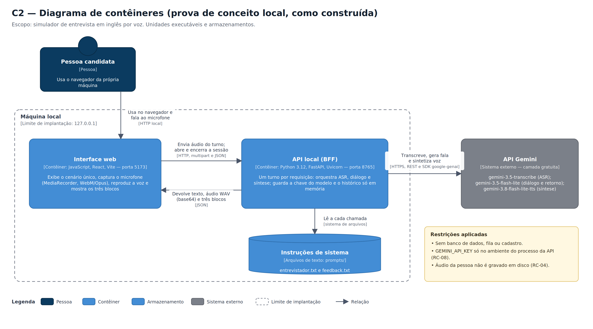
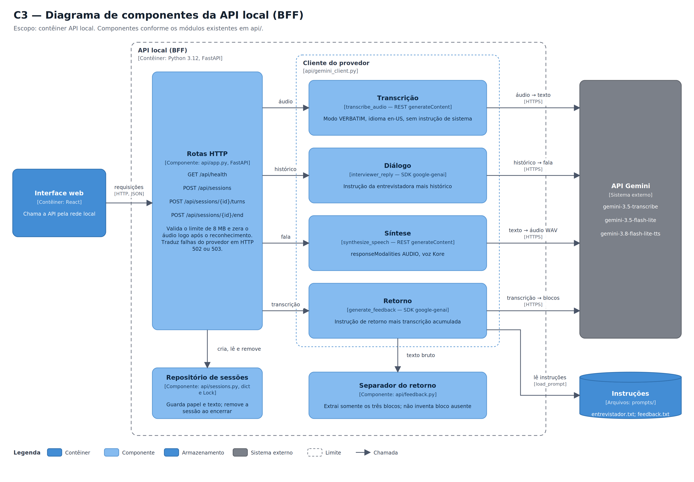
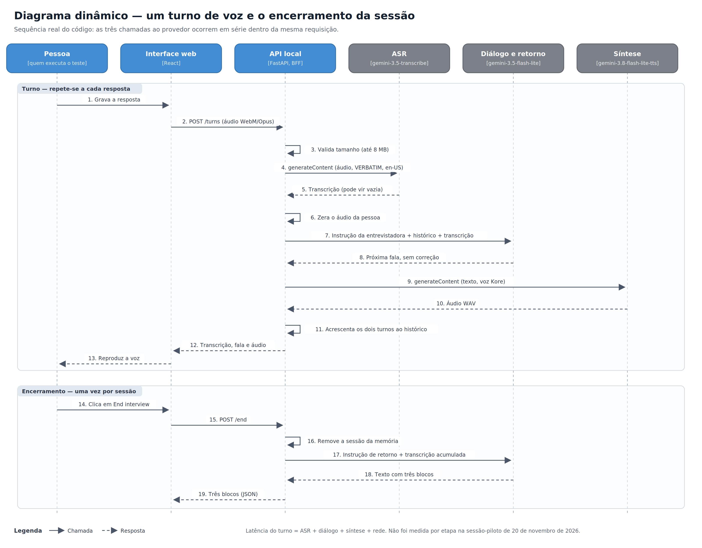

# Documento de Arquitetura de Software (DAS)

**Projeto:** Simulador de Conversação em Inglês com Inteligência Artificial  
**Sprint:** 3 — Sessão-piloto e fechamento do DAS  
**Versão:** 1.0 — rascunho para revisão  
**Data:** 20 de novembro de 2026  
**Versão anterior:** 0.2 (`docs/sprint-1/das-parcial.md`, repositório `poc-en-simulator`)  
**Responsável:** o aluno, no papel de arquiteto da solução

> Rascunho elaborado a partir do DAS v0.2, do código do repositório, do registro da sessão-piloto e da nota de privacidade. Antes de publicar no repositório, ajustar os caminhos das figuras (`diagramas-v2/`) para o destino e remover este aviso.

---

## 1. Objetivo e alcance do documento

Este documento descreve a arquitetura da prova de conceito como construída e validada na sessão-piloto de 20 de novembro de 2026. Também registra premissas, restrições, decisões e riscos, além de uma proposta de publicação em nuvem e uma visão de evolução. A proposta de nuvem não foi implantada, e a visão de evolução não pertence à versão 1.

O documento não afirma ganho de fluência, não generaliza a acurácia do reconhecimento de fala para o sotaque brasileiro e não inclui amostra externa (RC-07).

## 2. Contexto

A prova de conceito é um simulador de conversação em inglês por voz. A inteligência artificial (IA) atua como entrevistadora em um único cenário: entrevista de emprego na área de tecnologia. Quem usa a sessão-piloto é a própria pessoa que executa o teste, na máquina em que a interface e a interface de programação de aplicação (API) estão em execução.

O sistema depende de um único provedor externo, a API Gemini, na camada gratuita, para três funções: reconhecimento automático de fala (*Automatic Speech Recognition* — ASR), modelo de linguagem de grande porte (*Large Language Model* — LLM) e síntese de voz (*Text-to-Speech* — TTS).

## 3. Direcionadores arquiteturais

### 3.1 Requisitos funcionais

| ID | Requisito | Situação após a sessão-piloto |
|---|---|---|
| RF-01 | Cenário único de entrevista de emprego em tecnologia | Atendido |
| RF-02 | Captura da fala pelo microfone | Atendido |
| RF-03 | Transcrição suficiente para o diálogo continuar | Atendido na sessão de 20 de novembro de 2026 (quatro turnos não vazios) |
| RF-04 | Próxima fala em inglês, no papel de entrevistadora, sem correção | Atendido |
| RF-05 | Síntese e reprodução da fala | Atendido |
| RF-06 | Retorno em três blocos ao encerrar | Atendido |
| RF-07 | Histórico apenas em memória | Atendido (ver seção 9) |
| RF-08 | Chave do modelo fora do navegador | Atendido |

### 3.2 Restrições

| ID | Restrição |
|---|---|
| RC-01 | Prazo de 21 dias corridos, de 2 a 22 de novembro de 2026, em três sprints |
| RC-02 | Orçamento nulo: somente camada gratuita e ferramentas sem custo |
| RC-03 | Execução local; a publicação em nuvem não é condição de conclusão |
| RC-04 | Sem armazenamento de áudio nem de transcrição pela aplicação |
| RC-05 | Cenário único |
| RC-06 | Correção somente ao final |
| RC-07 | Sem afirmação de ganho de fluência |
| RC-08 | Chave do modelo fora do navegador |
| RC-09 | Sessão-piloto apenas com a voz de quem executa o teste |

### 3.3 Atributos de qualidade priorizados

| Prioridade | Atributo | Como a arquitetura responde |
|---|---|---|
| 1 | Privacidade | Áudio descartado após o ASR; nada gravado em disco; chave isolada no processo da API |
| 2 | Custo | Provedor único na camada gratuita; execução local |
| 3 | Simplicidade | Dois contêineres, sem banco, fila ou cadastro |
| 4 | Latência percebida | Turno síncrono e indicador de processamento na interface; medição por etapa pendente |
| 5 | Substituibilidade | Funções de ASR, diálogo e síntese já separadas no cliente do provedor; portas formais propostas (M-03) |

## 4. Premissas

| ID | Premissa | Situação em 20 de novembro de 2026 |
|---|---|---|
| P-01 | Microfone, internet estável e computador capaz de executar interface e API | Confirmada na sessão-piloto |
| P-02 | Oferta gratuita de ASR, LLM e TTS acessível durante as sprints | Confirmada; nenhuma chamada da sessão falhou |
| P-03 | Cinco a dez minutos bastam para percorrer o fluxo | Confirmada: oito minutos e 22 segundos |
| P-04 | A sessão é simulação, distinta de entrevista real | Mantida |

## 5. Visão geral

A arquitetura segue o padrão de voz em cascata, descrito na documentação de agentes de voz da OpenAI como adequado quando cada etapa precisa ser visível ou substituível (OPENAI, 2026). O mesmo padrão aparece nas amostras oficiais da AWS com Amazon Transcribe, Bedrock e Polly (AMAZON WEB SERVICES, 2026a). Neste projeto, a transcrição literal precisa ficar visível porque é a matéria-prima do retorno final.

## 6. Contexto do sistema (C4, nível 1)

O sistema tem um único ator, a pessoa que executa o teste, e um único sistema externo, a API Gemini. Provedor de identidade, banco de dados e repositório de conteúdo ficam fora do contexto da versão 1, por decisão de escopo.

## 7. Contêineres (C4, nível 2)

| Contêiner | Tecnologia | Responsabilidade |
|---|---|---|
| Interface web | JavaScript, React, Vite (porta 5173) | Exibir o cenário único, capturar o microfone em WebM/Opus, reproduzir a voz e mostrar os três blocos |
| API local (BFF) | Python 3.12, FastAPI, Uvicorn (porta 8765) | Receber o áudio do turno, chamar ASR, diálogo e síntese em sequência, devolver texto e áudio, guardar o histórico só em memória e isolar a chave |
| Instruções de sistema | Arquivos de texto em `prompts/` | Instrução da entrevistadora (em inglês) e instrução do retorno (em português) |
| API Gemini | Sistema externo | `gemini-3.5-transcribe`, `gemini-3.5-flash-lite` e `gemini-3.8-flash-lite-tts` |

A API segue o padrão *Backend for Frontend* (BFF): o navegador conversa apenas com a API local, e só a API conhece a chave do provedor.

## 8. Componentes da API (C4, nível 3)

| Componente | Módulo | Responsabilidade |
|---|---|---|
| Rotas HTTP | `api/app.py` | `GET /api/health`, `POST /api/sessions`, `POST /api/sessions/{id}/turns`, `POST /api/sessions/{id}/end`; validação do limite de 8 MB; descarte do áudio após o ASR |
| Repositório de sessões | `api/sessions.py` | Dicionário em memória protegido por *lock*; guarda apenas papel e texto |
| Transcrição | `gemini_client.transcribe_audio` | REST `generateContent`, modo `VERBATIM`, idioma `en-US`, sem instrução de sistema |
| Diálogo | `gemini_client.interviewer_reply` | SDK `google-genai`, instrução da entrevistadora mais histórico |
| Síntese | `gemini_client.synthesize_speech` | REST `generateContent`, `responseModalities AUDIO`, voz Kore |
| Retorno | `gemini_client.generate_feedback` | SDK `google-genai`, instrução de retorno mais transcrição acumulada |
| Separador do retorno | `api/feedback.py` | Extrai os três blocos sem inventar bloco ausente |
| Configuração | `api/settings.py` | Modelos, idioma, limite de áudio e tempo-limite das chamadas |

## 9. Visão dinâmica

Cada turno é uma requisição HTTP síncrona com três chamadas ao provedor em série. O áudio da pessoa é zerado logo após o reconhecimento. O histórico textual é atualizado somente depois que o diálogo e a síntese concluem; se uma das chamadas falhar, o turno não entra no histórico. No encerramento, a sessão é removida da memória antes da chamada de retorno.

## 10. Decisões arquiteturais

| ID | Decisão | Alternativa descartada | Motivo | Consequência |
|---|---|---|---|---|
| AD-01 | Cascata ASR → LLM → TTS | *Live API* (áudio contínuo bidirecional) | Canal bidirecional está fora do escopo; a transcrição precisa ficar visível para o retorno | Latência maior que a de modelos de voz para voz |
| AD-02 | API local no padrão BFF | Chamada direta do navegador ao provedor | RC-08 | Um processo a mais na máquina local |
| AD-03 | Turno síncrono, uma requisição por resposta | Fila ou WebSocket | Fluxo do tipo “aperte para falar”; menor complexidade | A pessoa espera as três etapas; o tempo total depende do provedor |
| AD-04 | Histórico só em memória | Banco de dados | RC-04 e escopo | Sessão perdida se o processo reiniciar; impede múltiplas instâncias sem ajuste (seção 13) |
| AD-05 | Transcrição em modo `VERBATIM` | Modo que limpa hesitações | O retorno precisa das hesitações reais | O texto mostra repetições como “involve involve” |
| AD-06 | Provedor único, API Gemini, camada gratuita | Combinação de provedores | RC-02 e prazo | Conteúdo pode ser usado pelo provedor; motiva RC-09 |
| AD-07 | Síntese e transcrição por REST; diálogo por SDK | SDK em todas as chamadas | O SDK `google-genai` 3.1.0 recusou `speechConfig` na Sprint 1 | Dois estilos de integração no mesmo módulo |
| AD-08 | Publicação opcional em AWS serverless | Containers em ECS Fargate | Custo dentro do Free plan e operação simples | Exige API sem estado e tempos-limite curtos (seção 13) |

## 11. Privacidade e segurança

A nota de privacidade de 20 de novembro de 2026 confirma o comportamento a partir do código. `[FONTE-PRIMÁRIA]`

- **Áudio da pessoa:** enviado ao reconhecimento e zerado em seguida (`audio_bytes = b""`); não é gravado em disco.
- **Transcrição:** permanece em `session.history`, na memória do processo, até `POST /end`, quando a sessão é removida e `history.clear()` é chamado. Se o encerramento não for chamado, o histórico permanece no processo.
- **Navegador:** guarda falas e blocos em estado React enquanto a página estiver aberta; não usa `localStorage`, `sessionStorage` nem IndexedDB.
- **Provedor:** na camada gratuita, o conteúdo pode ser usado para melhorar produtos e lido por revisores humanos, e os termos orientam a não enviar informação pessoal (GOOGLE, 2026). A aplicação não controla essa retenção. Por isso vale RC-09.

A nota não certifica conformidade com a Lei Geral de Proteção de Dados (LGPD).

| Risco OWASP (OWASP, 2025) | Situação na versão 1 | Mitigação |
|---|---|---|
| LLM01 — *prompt injection* | A fala transcrita entra no histórico do diálogo | Uso individual; instrução de sistema fixa; delimitar a fala transcrita (M-08) |
| LLM02 — vazamento de informação sensível | Conteúdo enviado ao provedor na camada gratuita | RC-09; não enviar dados de terceiros |
| LLM10 — consumo sem limite | API escuta só em `127.0.0.1` | Na publicação, limite de requisições no API Gateway |

## 12. Resultado da sessão-piloto

`[FONTE-PRIMÁRIA]` Registro em `docs/sprint-3/registro-sessao-piloto.md`.

| Critério da Sprint 3 | Resultado |
|---|---|
| Duração de cinco a dez minutos | Oito minutos e 22 segundos (21:11:25 a 21:19:47) |
| Ao menos quatro turnos reconhecidos | Quatro turnos com transcrição não vazia |
| Resposta oral | Cada turno devolveu a fala seguinte com áudio |
| Retorno em três blocos | Devolvido após “End interview”, com trechos da própria sessão |
| Falhas | Nenhuma chamada HTTP falhou |

**Limitações registradas:** a transcrição manteve hesitações e trechos truncados, compatíveis com o modo literal. No turno 1, a transcrição registra “closure”, e a entrevistadora perguntou sobre “Clojure”. O resultado não prova acurácia para o sotaque brasileiro. A latência por etapa não foi medida: `[LACUNA DE EVIDÊNCIA — duração de ASR, diálogo e síntese por turno]`.

## 13. Implantação proposta na AWS (entrega 4, opcional)

A proposta mantém o mesmo código da API e publica a interface como arquivos estáticos. Ela não foi implantada nesta versão.

| Elemento | Serviço | Justificativa |
|---|---|---|
| Distribuição e HTTPS | Amazon CloudFront | Mesma origem para interface e `/api/*`, o que dispensa CORS entre domínios |
| Interface | Amazon S3 com OAC | Bucket privado, acessado só pela distribuição |
| Entrada da API | Amazon API Gateway, HTTP API | Limite de requisições por rota; integração simples com Lambda |
| Execução | AWS Lambda, Python 3.12, Lambda Web Adapter | Executa a aplicação FastAPI sem reescrita (AMAZON WEB SERVICES, 2026f) |
| Chave | AWS Systems Manager Parameter Store (SecureString) | Sem custo na camada padrão, ao contrário do Secrets Manager |
| Observabilidade | Amazon CloudWatch | Latência por etapa e erros, sem conteúdo de fala, com retenção curta |

**Ajustes de código exigidos antes da implantação:**

1. API sem estado, com o histórico textual enviado pelo navegador a cada turno, porque instâncias Lambda não compartilham memória.
2. Endereço da API e CORS por variável de ambiente.
3. Limite de áudio de até 4 MB, porque o payload síncrono da Lambda é de 6 MB (AMAZON WEB SERVICES, 2026b).
4. Tempos-limite por etapa com soma inferior a 30 s, o teto da integração do HTTP API (AMAZON WEB SERVICES, 2026c).

**Alternativas consideradas:** a URL de função Lambda não tem o teto de 30 s, mas, atrás do CloudFront com OAC, exige que o cliente envie o hash SHA-256 do corpo em requisições POST (AMAZON WEB SERVICES, 2026d). ECS Fargate e App Runner mantêm o processo com estado em memória, mas cobram por tempo ativo, o que contraria RC-02. Microsoft Azure ou outro provedor equivalente podem receber a mesma topologia.

**Condição de uso:** mesmo publicada, a aplicação continua restrita a quem executa o teste (RC-09). O Free plan encerra a conta em seis meses ou ao fim dos créditos (AMAZON WEB SERVICES, 2026e), de modo que a publicação seria temporária.

## 14. Riscos e limitações

| ID | Risco | Situação | Resposta |
|---|---|---|---|
| R-04 | Privacidade e retenção de áudio | Áudio descartado; provedor pode usar o conteúdo | RC-09; camada paga ou provedores AWS na versão 2 |
| R-05 | Latência do pipeline ASR → LLM → TTS | Não medida por etapa | Instrumentação M-01; indicador acima de oito segundos |
| R-06 | Custo de APIs | Nulo na camada gratuita | Sessões curtas; cotas do provedor |
| — | Acurácia do ASR para sotaque brasileiro | Quatro turnos reconhecidos em uma sessão, com uma única voz | Não generalizar; teste com amostra externa na versão 2 |
| — | Retorno com conteúdo inferido | Ocorreu na Sprint 2 com transcrição vazia | Regra determinística no código (M-04) |
| — | Dependência de um único provedor | Indisponibilidade interrompe o fluxo | Portas separadas por etapa (M-03) |

## 15. Evolução

Os elementos das propostas anteriores, como banco de dados, contas de usuário, fila de avaliação e RAG, ficam na versão 2. Cada um entra somente quando um requisito, uma medição ou uma decisão registrada o justificar.

## 16. Referências

AMAZON WEB SERVICES. **amazon-bedrock-voice-conversation**. GitHub, 2026a. Disponível em: https://github.com/aws-samples/amazon-bedrock-voice-conversation. Acesso em: 20 nov. 2026.

AMAZON WEB SERVICES. **Lambda quotas**. AWS Lambda Developer Guide, 2026b. Disponível em: https://docs.aws.amazon.com/lambda/latest/dg/gettingstarted-limits.html. Acesso em: 20 nov. 2026.

AMAZON WEB SERVICES. **Quotas for configuring and running an HTTP API in API Gateway**. Amazon API Gateway Developer Guide, 2026c. Disponível em: https://docs.aws.amazon.com/apigateway/latest/developerguide/http-api-quotas.html. Acesso em: 20 nov. 2026.

AMAZON WEB SERVICES. **Restrict access to an AWS Lambda function URL origin**. Amazon CloudFront Developer Guide, 2026d. Disponível em: https://docs.aws.amazon.com/AmazonCloudFront/latest/DeveloperGuide/private-content-restricting-access-to-lambda.html. Acesso em: 20 nov. 2026.

AMAZON WEB SERVICES. **AWS Free Tier**. 2026e. Disponível em: https://aws.amazon.com/free/. Acesso em: 20 nov. 2026.

AMAZON WEB SERVICES. **Response streaming**: AWS Lambda Web Adapter user guide. 2026f. Disponível em: https://aws.github.io/aws-lambda-web-adapter/configuration/response-streaming.html. Acesso em: 20 nov. 2026.

BROWN, Simon. **The C4 model for visualising software architecture**. 2026. Disponível em: https://c4model.com/. Acesso em: 20 nov. 2026.

GOOGLE. **Gemini API Additional Terms of Service**. Vigência a partir de 23 mar. 2026. Disponível em: https://aistudio.google.com/docs/terms. Acesso em: 20 nov. 2026.

OPENAI. **Voice agents**. OpenAI API documentation, 2026. Disponível em: https://developers.openai.com/api/docs/guides/voice-agents. Acesso em: 20 nov. 2026.

OWASP. **OWASP Top 10 for LLM Applications 2025**. OWASP Gen AI Security Project, 2025. Disponível em: https://genai.owasp.org/llm-top-10/. Acesso em: 20 nov. 2026.
