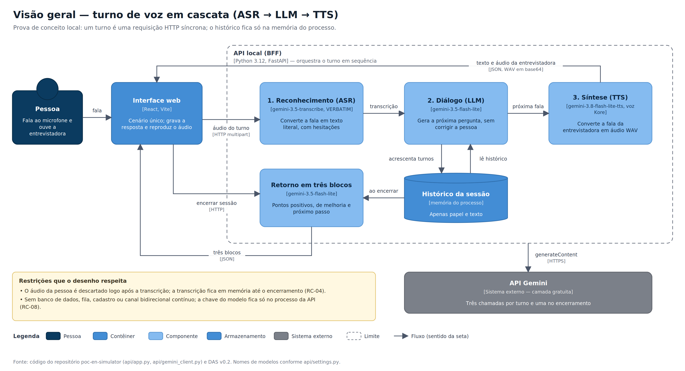
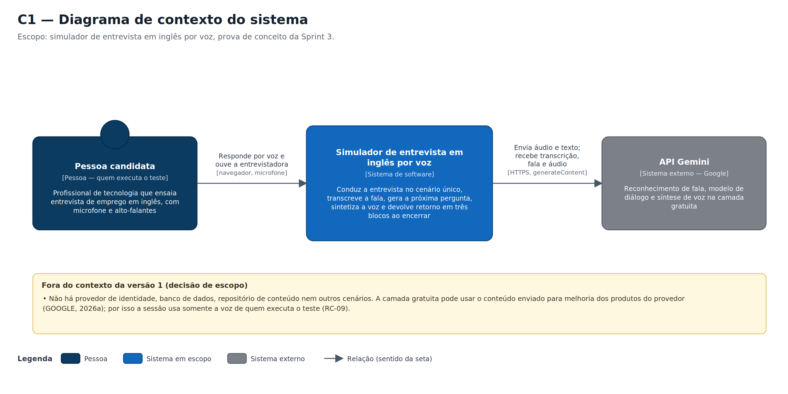
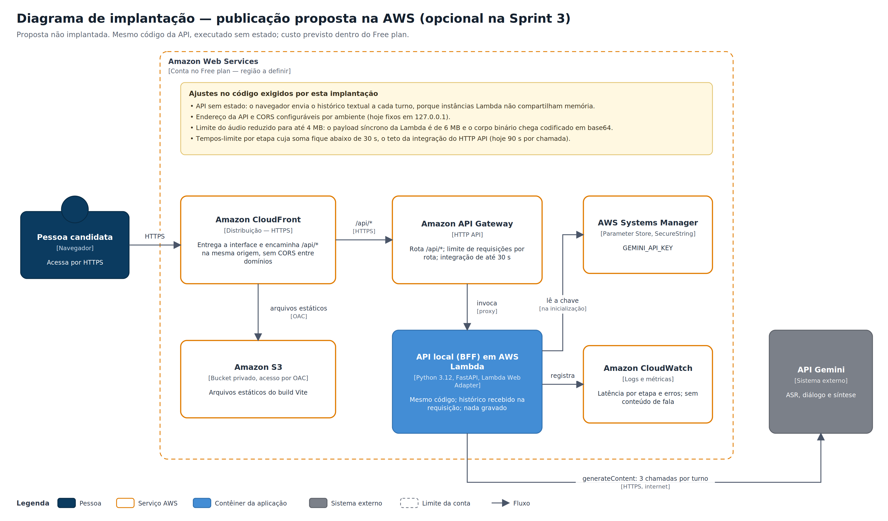
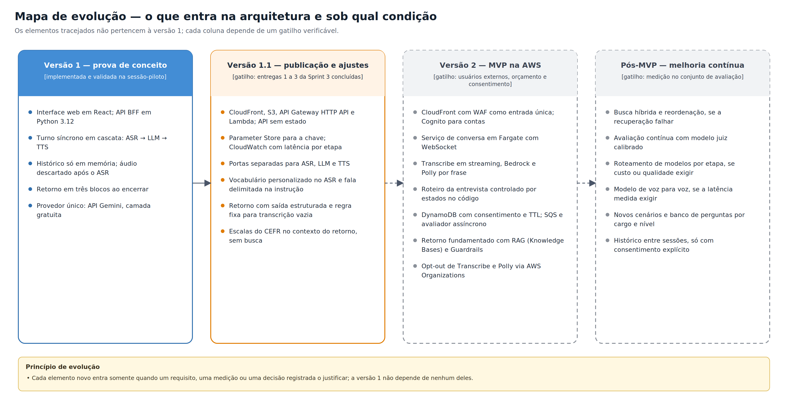
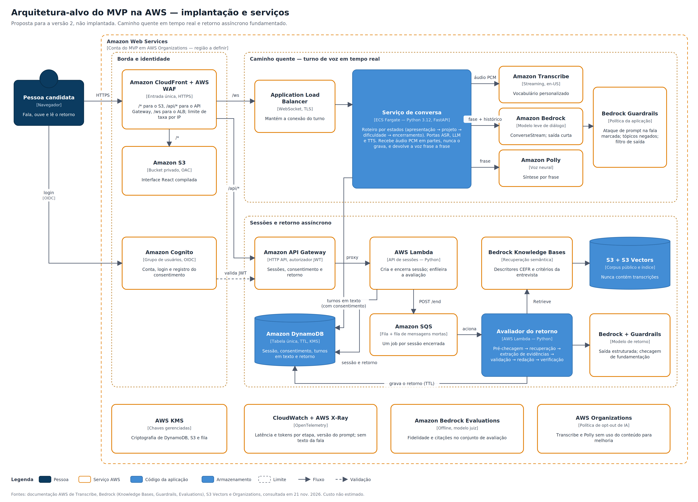
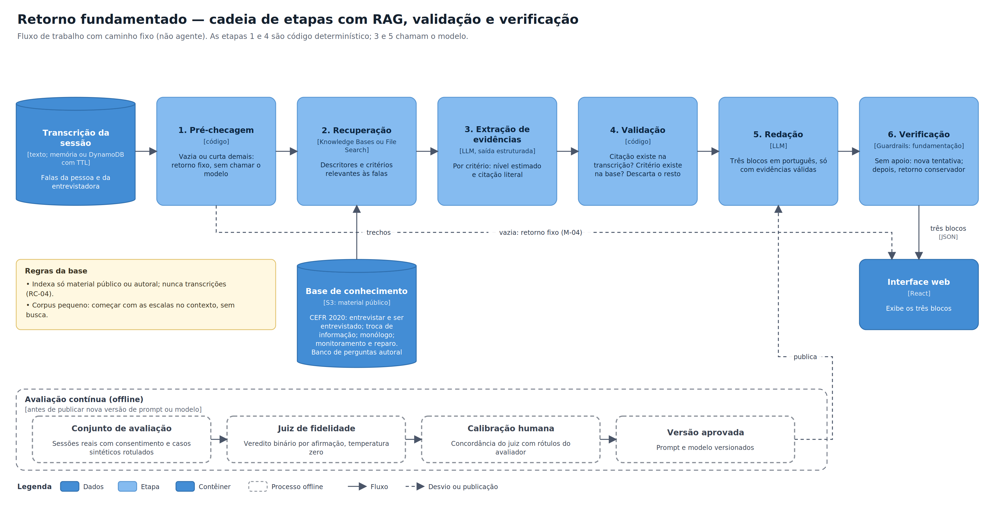

# Documento de Arquitetura de Software (DAS)

**Projeto:** Simulador de Conversação em Inglês com Inteligência Artificial  
**Sprint:** 3 — Sessão-piloto e fechamento do DAS  
**Versão:** 1.0 — rascunho para revisão  
**Data:** 20 de novembro de 2026  
**Versão anterior:** 0.2 (`docs/sprint-1/das-parcial.md`, repositório `poc-en-simulator`)  
**Responsável:** o aluno, no papel de arquiteto da solução

> Rascunho elaborado a partir do DAS v0.2, do código do repositório, do registro da sessão-piloto e da nota de privacidade. Antes de publicar no repositório, ajustar os caminhos das figuras (`diagramas-v2/`) para o destino e remover este aviso.

---

## 1. Objetivo e alcance do documento

Este documento descreve a arquitetura da prova de conceito como construída e validada na sessão-piloto de 20 de novembro de 2026. Também registra premissas, restrições, decisões e riscos, além de uma proposta de publicação em nuvem e uma visão de evolução, que inclui a arquitetura-alvo de um produto mínimo viável (*Minimum Viable Product* — MVP) na AWS e um catálogo de técnicas de melhoria no uso do modelo de linguagem. Nenhuma dessas propostas foi implantada, e a visão de evolução não pertence à versão 1.

O documento não afirma ganho de fluência, não generaliza a acurácia do reconhecimento de fala para o sotaque brasileiro e não inclui amostra externa (RC-07).

## 2. Contexto

A prova de conceito é um simulador de conversação em inglês por voz. A inteligência artificial (IA) atua como entrevistadora em um único cenário: entrevista de emprego na área de tecnologia. Quem usa a sessão-piloto é a própria pessoa que executa o teste, na máquina em que a interface e a interface de programação de aplicação (API) estão em execução.

O sistema depende de um único provedor externo, a API Gemini, na camada gratuita, para três funções: reconhecimento automático de fala (*Automatic Speech Recognition* — ASR), modelo de linguagem de grande porte (*Large Language Model* — LLM) e síntese de voz (*Text-to-Speech* — TTS).

## 3. Direcionadores arquiteturais

### 3.1 Requisitos funcionais

| ID | Requisito | Situação após a sessão-piloto |
|---|---|---|
| RF-01 | Cenário único de entrevista de emprego em tecnologia | Atendido |
| RF-02 | Captura da fala pelo microfone | Atendido |
| RF-03 | Transcrição suficiente para o diálogo continuar | Atendido na sessão de 20 de novembro de 2026 (quatro turnos não vazios) |
| RF-04 | Próxima fala em inglês, no papel de entrevistadora, sem correção | Atendido |
| RF-05 | Síntese e reprodução da fala | Atendido |
| RF-06 | Retorno em três blocos ao encerrar | Atendido |
| RF-07 | Histórico apenas em memória | Atendido (ver seção 9) |
| RF-08 | Chave do modelo fora do navegador | Atendido |

### 3.2 Restrições

| ID | Restrição |
|---|---|
| RC-01 | Prazo de 21 dias corridos, de 2 a 22 de novembro de 2026, em três sprints |
| RC-02 | Orçamento nulo: somente camada gratuita e ferramentas sem custo |
| RC-03 | Execução local; a publicação em nuvem não é condição de conclusão |
| RC-04 | Sem armazenamento de áudio nem de transcrição pela aplicação |
| RC-05 | Cenário único |
| RC-06 | Correção somente ao final |
| RC-07 | Sem afirmação de ganho de fluência |
| RC-08 | Chave do modelo fora do navegador |
| RC-09 | Sessão-piloto apenas com a voz de quem executa o teste |

### 3.3 Atributos de qualidade priorizados

| Prioridade | Atributo | Como a arquitetura responde |
|---|---|---|
| 1 | Privacidade | Áudio descartado após o ASR; nada gravado em disco; chave isolada no processo da API |
| 2 | Custo | Provedor único na camada gratuita; execução local |
| 3 | Simplicidade | Dois contêineres, sem banco, fila ou cadastro |
| 4 | Latência percebida | Turno síncrono e indicador de processamento na interface; medição por etapa pendente |
| 5 | Substituibilidade | Funções de ASR, diálogo e síntese já separadas no cliente do provedor; portas formais propostas (M-03) |

## 4. Premissas

| ID | Premissa | Situação em 20 de novembro de 2026 |
|---|---|---|
| P-01 | Microfone, internet estável e computador capaz de executar interface e API | Confirmada na sessão-piloto |
| P-02 | Oferta gratuita de ASR, LLM e TTS acessível durante as sprints | Confirmada; nenhuma chamada da sessão falhou |
| P-03 | Cinco a dez minutos bastam para percorrer o fluxo | Confirmada: oito minutos e 22 segundos |
| P-04 | A sessão é simulação, distinta de entrevista real | Mantida |

## 5. Visão geral

A arquitetura segue o padrão de voz em cascata, descrito na documentação de agentes de voz da OpenAI como adequado quando cada etapa precisa ser visível ou substituível (OPENAI, 2026). O mesmo padrão aparece nas amostras oficiais da AWS com Amazon Transcribe, Bedrock e Polly (AMAZON WEB SERVICES, 2026a). Neste projeto, a transcrição literal precisa ficar visível porque é a matéria-prima do retorno final.

## 6. Contexto do sistema (C4, nível 1)

O sistema tem um único ator, a pessoa que executa o teste, e um único sistema externo, a API Gemini. Provedor de identidade, banco de dados e repositório de conteúdo ficam fora do contexto da versão 1, por decisão de escopo.

## 7. Contêineres (C4, nível 2)

| Contêiner | Tecnologia | Responsabilidade |
|---|---|---|
| Interface web | JavaScript, React, Vite (porta 5173) | Exibir o cenário único, capturar o microfone em WebM/Opus, reproduzir a voz e mostrar os três blocos |
| API local (BFF) | Python 3.12, FastAPI, Uvicorn (porta 8765) | Receber o áudio do turno, chamar ASR, diálogo e síntese em sequência, devolver texto e áudio, guardar o histórico só em memória e isolar a chave |
| Instruções de sistema | Arquivos de texto em `prompts/` | Instrução da entrevistadora (em inglês) e instrução do retorno (em português) |
| API Gemini | Sistema externo | `gemini-3.5-transcribe`, `gemini-3.5-flash-lite` e `gemini-3.8-flash-lite-tts` |

A API segue o padrão *Backend for Frontend* (BFF): o navegador conversa apenas com a API local, e só a API conhece a chave do provedor.

## 8. Componentes da API (C4, nível 3)

| Componente | Módulo | Responsabilidade |
|---|---|---|
| Rotas HTTP | `api/app.py` | `GET /api/health`, `POST /api/sessions`, `POST /api/sessions/{id}/turns`, `POST /api/sessions/{id}/end`; validação do limite de 8 MB; descarte do áudio após o ASR |
| Repositório de sessões | `api/sessions.py` | Dicionário em memória protegido por *lock*; guarda apenas papel e texto |
| Transcrição | `gemini_client.transcribe_audio` | REST `generateContent`, modo `VERBATIM`, idioma `en-US`, sem instrução de sistema |
| Diálogo | `gemini_client.interviewer_reply` | SDK `google-genai`, instrução da entrevistadora mais histórico |
| Síntese | `gemini_client.synthesize_speech` | REST `generateContent`, `responseModalities AUDIO`, voz Kore |
| Retorno | `gemini_client.generate_feedback` | SDK `google-genai`, instrução de retorno mais transcrição acumulada |
| Separador do retorno | `api/feedback.py` | Extrai os três blocos sem inventar bloco ausente |
| Configuração | `api/settings.py` | Modelos, idioma, limite de áudio e tempo-limite das chamadas |

## 9. Visão dinâmica

Cada turno é uma requisição HTTP síncrona com três chamadas ao provedor em série. O áudio da pessoa é zerado logo após o reconhecimento. O histórico textual é atualizado somente depois que o diálogo e a síntese concluem; se uma das chamadas falhar, o turno não entra no histórico. No encerramento, a sessão é removida da memória antes da chamada de retorno.

## 10. Decisões arquiteturais

| ID | Decisão | Alternativa descartada | Motivo | Consequência |
|---|---|---|---|---|
| AD-01 | Cascata ASR → LLM → TTS | *Live API* (áudio contínuo bidirecional) | Canal bidirecional está fora do escopo; a transcrição precisa ficar visível para o retorno | Latência maior que a de modelos de voz para voz |
| AD-02 | API local no padrão BFF | Chamada direta do navegador ao provedor | RC-08 | Um processo a mais na máquina local |
| AD-03 | Turno síncrono, uma requisição por resposta | Fila ou WebSocket | Fluxo do tipo “aperte para falar”; menor complexidade | A pessoa espera as três etapas; o tempo total depende do provedor |
| AD-04 | Histórico só em memória | Banco de dados | RC-04 e escopo | Sessão perdida se o processo reiniciar; impede múltiplas instâncias sem ajuste (seção 13) |
| AD-05 | Transcrição em modo `VERBATIM` | Modo que limpa hesitações | O retorno precisa das hesitações reais | O texto mostra repetições como “involve involve” |
| AD-06 | Provedor único, API Gemini, camada gratuita | Combinação de provedores | RC-02 e prazo | Conteúdo pode ser usado pelo provedor; motiva RC-09 |
| AD-07 | Síntese e transcrição por REST; diálogo por SDK | SDK em todas as chamadas | O SDK `google-genai` 3.1.0 recusou `speechConfig` na Sprint 1 | Dois estilos de integração no mesmo módulo |
| AD-08 | Publicação opcional em AWS serverless | Containers em ECS Fargate | Custo dentro do Free plan e operação simples | Exige API sem estado e tempos-limite curtos (seção 13) |

## 11. Privacidade e segurança

A nota de privacidade de 20 de novembro de 2026 confirma o comportamento a partir do código. `[FONTE-PRIMÁRIA]`

- **Áudio da pessoa:** enviado ao reconhecimento e zerado em seguida (`audio_bytes = b""`); não é gravado em disco.
- **Transcrição:** permanece em `session.history`, na memória do processo, até `POST /end`, quando a sessão é removida e `history.clear()` é chamado. Se o encerramento não for chamado, o histórico permanece no processo.
- **Navegador:** guarda falas e blocos em estado React enquanto a página estiver aberta; não usa `localStorage`, `sessionStorage` nem IndexedDB.
- **Provedor:** na camada gratuita, o conteúdo pode ser usado para melhorar produtos e lido por revisores humanos, e os termos orientam a não enviar informação pessoal (GOOGLE, 2026a). A aplicação não controla essa retenção. Por isso vale RC-09.

A nota não certifica conformidade com a Lei Geral de Proteção de Dados (LGPD).

| Risco OWASP (OWASP, 2025) | Situação na versão 1 | Mitigação |
|---|---|---|
| LLM01 — *prompt injection* | A fala transcrita entra no histórico do diálogo | Uso individual; instrução de sistema fixa; delimitar a fala transcrita (M-08) |
| LLM02 — vazamento de informação sensível | Conteúdo enviado ao provedor na camada gratuita | RC-09; não enviar dados de terceiros |
| LLM10 — consumo sem limite | API escuta só em `127.0.0.1` | Na publicação, limite de requisições no API Gateway |

## 12. Resultado da sessão-piloto

`[FONTE-PRIMÁRIA]` Registro em `docs/sprint-3/registro-sessao-piloto.md`.

| Critério da Sprint 3 | Resultado |
|---|---|
| Duração de cinco a dez minutos | Oito minutos e 22 segundos (21:11:25 a 21:19:47) |
| Ao menos quatro turnos reconhecidos | Quatro turnos com transcrição não vazia |
| Resposta oral | Cada turno devolveu a fala seguinte com áudio |
| Retorno em três blocos | Devolvido após “End interview”, com trechos da própria sessão |
| Falhas | Nenhuma chamada HTTP falhou |

**Limitações registradas:** a transcrição manteve hesitações e trechos truncados, compatíveis com o modo literal. No turno 1, a transcrição registra “closure”, e a entrevistadora perguntou sobre “Clojure”. O resultado não prova acurácia para o sotaque brasileiro. A latência por etapa não foi medida: `[LACUNA DE EVIDÊNCIA — duração de ASR, diálogo e síntese por turno]`.

## 13. Implantação proposta na AWS (entrega 4, opcional)

A proposta mantém o mesmo código da API e publica a interface como arquivos estáticos. Ela não foi implantada nesta versão.

| Elemento | Serviço | Justificativa |
|---|---|---|
| Distribuição e HTTPS | Amazon CloudFront | Mesma origem para interface e `/api/*`, o que dispensa CORS entre domínios |
| Interface | Amazon S3 com OAC | Bucket privado, acessado só pela distribuição |
| Entrada da API | Amazon API Gateway, HTTP API | Limite de requisições por rota; integração simples com Lambda |
| Execução | AWS Lambda, Python 3.12, Lambda Web Adapter | Executa a aplicação FastAPI sem reescrita (AMAZON WEB SERVICES, 2026f) |
| Chave | AWS Systems Manager Parameter Store (SecureString) | Sem custo na camada padrão, ao contrário do Secrets Manager |
| Observabilidade | Amazon CloudWatch | Latência por etapa e erros, sem conteúdo de fala, com retenção curta |

**Ajustes de código exigidos antes da implantação:**

1. API sem estado, com o histórico textual enviado pelo navegador a cada turno, porque instâncias Lambda não compartilham memória.
2. Endereço da API e CORS por variável de ambiente.
3. Limite de áudio de até 4 MB, porque o payload síncrono da Lambda é de 6 MB (AMAZON WEB SERVICES, 2026b).
4. Tempos-limite por etapa com soma inferior a 30 s, o teto da integração do HTTP API (AMAZON WEB SERVICES, 2026c).

**Alternativas consideradas:** a URL de função Lambda não tem o teto de 30 s, mas, atrás do CloudFront com OAC, exige que o cliente envie o hash SHA-256 do corpo em requisições POST (AMAZON WEB SERVICES, 2026d). ECS Fargate e App Runner mantêm o processo com estado em memória, mas cobram por tempo ativo, o que contraria RC-02. Microsoft Azure ou outro provedor equivalente podem receber a mesma topologia.

**Condição de uso:** mesmo publicada, a aplicação continua restrita a quem executa o teste (RC-09). O Free plan encerra a conta em seis meses ou ao fim dos créditos (AMAZON WEB SERVICES, 2026e), de modo que a publicação seria temporária.

## 14. Riscos e limitações

| ID | Risco | Situação | Resposta |
|---|---|---|---|
| R-04 | Privacidade e retenção de áudio | Áudio descartado; provedor pode usar o conteúdo | RC-09; camada paga ou provedores AWS na versão 2 |
| R-05 | Latência do pipeline ASR → LLM → TTS | Não medida por etapa | Instrumentação M-01; indicador acima de oito segundos |
| R-06 | Custo de APIs | Nulo na camada gratuita | Sessões curtas; cotas do provedor |
| — | Acurácia do ASR para sotaque brasileiro | Quatro turnos reconhecidos em uma sessão, com uma única voz | Não generalizar; teste com amostra externa na versão 2 |
| — | Retorno com conteúdo inferido | Ocorreu na Sprint 2 com transcrição vazia | Regra determinística no código (M-04) |
| — | Dependência de um único provedor | Indisponibilidade interrompe o fluxo | Portas separadas por etapa (M-03) |

## 15. Evolução

Esta seção reúne o que o projeto aprendeu nas três sprints e o organiza em etapas de evolução. Nada do que se descreve aqui foi implantado nem pertence ao escopo da Sprint 3. O objetivo é deixar registrado o caminho da prova de conceito até um produto e as condições para percorrê-lo.

### 15.1 Princípio e mapa de evolução

Cada elemento novo entra somente quando um requisito, uma medição ou uma decisão registrada o justificar. A versão 1.1 combina a publicação opcional da seção 13 com ajustes de baixo custo no uso do modelo. A versão 2 corresponde ao MVP descrito na subseção 15.2. A coluna pós-MVP reúne técnicas que dependem de medição no conjunto de avaliação descrito na subseção 15.3.

### 15.2 Arquitetura-alvo do MVP na AWS

A arquitetura-alvo consolida os elementos das propostas anteriores (contas de usuário, banco de dados, fila de avaliação e geração aumentada por recuperação, ou *Retrieval-Augmented Generation* — RAG) e os aprendizados da versão 1 e da sessão-piloto. Ela mantém o padrão em cascata (AD-01), porque a transcrição visível continua sendo a matéria-prima do retorno, mas troca o turno síncrono por um canal em tempo real e o retorno síncrono por um processamento assíncrono e fundamentado.

#### 15.2.1 Restrições revistas

O MVP só faz sentido se algumas restrições da versão 1 forem revistas por decisão registrada. A tabela indica o que muda.

| Restrição da versão 1 | Situação no MVP |
|---|---|
| RC-02 — orçamento nulo | Orçamento definido para os serviços AWS. `[LACUNA DE EVIDÊNCIA — custo por sessão não estimado; usar a AWS Pricing Calculator com o perfil de uso do piloto]` |
| RC-03 — execução local | Publicação em nuvem como condição do produto |
| RC-04 — sem armazenamento de áudio nem de transcrição | Áudio continua sem armazenamento. A transcrição textual passa a ser guardada somente com consentimento explícito e com expiração automática (TTL) |
| RC-05 — cenário único | Mantida no MVP; novos cenários ficam para o pós-MVP |
| RC-06 — correção somente ao final | Mantida |
| RC-07 — sem afirmação de ganho de fluência | Mantida; qualquer afirmação desse tipo exige estudo com amostra e método próprios |
| RC-09 — sessão apenas com a voz de quem testa | Substituída por consentimento explícito e por serviços que não usam o conteúdo para melhoria, ou que permitem desativar esse uso (subseção 15.2.5) |

#### 15.2.2 Elementos da arquitetura

| Camada | Serviço | Papel no MVP |
|---|---|---|
| Borda | Amazon CloudFront com AWS WAF | Entrada única por HTTPS: `/*` para a interface, `/api/*` para a API de sessões e `/ws` para o canal de voz. Regras de limite de taxa respondem a LLM10 |
| Interface | Amazon S3 com OAC | Arquivos estáticos do React. A captura passa a enviar áudio PCM em partes, porque o Transcribe em streaming aceita PCM, FLAC e Ogg/Opus, mas não WebM (AMAZON WEB SERVICES, 2026l) |
| Identidade | Amazon Cognito | Conta, login e registro do consentimento; emite o token validado pelo API Gateway e pelo serviço de conversa |
| Caminho quente | Application Load Balancer e serviço de conversa em ECS Fargate | Evolução direta da API FastAPI atual. A conexão WebSocket persistente permite enviar áudio enquanto a pessoa fala e devolver a voz frase a frase, sem o teto de 30 s do HTTP API |
| Reconhecimento de fala | Amazon Transcribe em streaming, `en-US` | Vocabulário personalizado com termos técnicos, como “Clojure”, para tratar o erro observado na sessão-piloto (AMAZON WEB SERVICES, 2026m) |
| Diálogo | Amazon Bedrock, modelo leve | Resposta em streaming, curta e no papel de entrevistadora |
| Síntese de voz | Amazon Polly, voz neural | Síntese por frase, iniciada assim que cada frase do diálogo fica pronta |
| Proteção do modelo | Amazon Bedrock Guardrails | Detecção de ataque de prompt na fala transcrita, que precisa vir marcada com as etiquetas de entrada do Guardrails (AMAZON WEB SERVICES, 2026j) |
| Sessões | Amazon API Gateway (HTTP API, autorizador JWT) e AWS Lambda | Criar e encerrar sessão, registrar consentimento, enfileirar a avaliação e devolver o retorno |
| Dados | Amazon DynamoDB com TTL e AWS KMS | Sessão, consentimento, turnos em texto e retorno, com expiração automática e criptografia |
| Processamento assíncrono | Amazon SQS com fila de mensagens mortas e AWS Lambda (avaliador) | Um job por sessão encerrada; retentativas sem perder o pedido |
| Recuperação (RAG) | Amazon Bedrock Knowledge Bases com S3 Vectors | Descritores do CEFR e critérios da entrevista. Com S3 Vectors, a Knowledge Base faz apenas busca semântica (AMAZON WEB SERVICES, 2026g) |
| Verificação do retorno | Bedrock Guardrails, checagem de fundamentação | Bloqueia afirmações sem apoio na transcrição. O nível *Classic* só aceita inglês, francês e espanhol; como o retorno é em português, exige o nível *Standard*, que depende de inferência entre regiões (AMAZON WEB SERVICES, 2026i) |
| Observabilidade | Amazon CloudWatch e AWS X-Ray com OpenTelemetry | Latência e tokens por etapa e versão da instrução, sem texto da fala nos registros |
| Qualidade | Amazon Bedrock Evaluations | Avaliação offline com modelo juiz: fidelidade e precisão de citação, inclusive para respostas geradas fora do Bedrock (AMAZON WEB SERVICES, 2026k) |
| Governança | AWS Organizations, política de *opt-out* de IA | Impede que Transcribe e Polly usem o conteúdo para melhoria do serviço (AMAZON WEB SERVICES, 2026o) |

#### 15.2.3 Fluxo de uma sessão no MVP

1. A pessoa faz login pelo Cognito e registra o consentimento.
2. A interface abre a conexão WebSocket pelo CloudFront e pelo ALB; o serviço de conversa valida o token.
3. Enquanto a pessoa fala, a interface envia partes do áudio em PCM. O serviço as repassa ao Transcribe em streaming e não grava nenhuma delas.
4. Ao fim da fala, o serviço envia ao Bedrock a transcrição final marcada para o Guardrails, a fase atual do roteiro e o histórico.
5. A resposta chega em streaming. Cada frase concluída segue para o Polly e é enviada ao navegador assim que o áudio fica pronto. Na versão 1, a reprodução só começa depois das três etapas. `[ASSUMPTION — requires validation]`: o ganho de latência percebida precisa ser medido com a instrumentação M-01.
6. O serviço atualiza o estado do roteiro e, com consentimento, grava o turno em texto no DynamoDB com TTL.
7. Ao encerrar, a interface chama `POST /end`. A Lambda de sessões enfileira o job no SQS, e o avaliador executa a cadeia da subseção 15.3, grava o retorno no DynamoDB e o devolve à interface.

#### 15.2.4 Decisões do MVP

| ID | Decisão | Alternativa descartada | Motivo | Consequência |
|---|---|---|---|---|
| AD-09 | Serviço de conversa em ECS Fargate com WebSocket | Lambda com HTTP API (versão 1.1) | Streaming de áudio e voz por frase exige conexão persistente; o HTTP API tem teto de 30 s | Custo por tempo ativo, com ao menos uma tarefa em execução |
| AD-10 | Transcribe, Bedrock e Polly como provedores principais | API Gemini na camada paga | O Bedrock não usa entradas nem saídas para treinar modelos (AMAZON WEB SERVICES, 2026p); Transcribe e Polly permitem *opt-out*; acesso por IAM, sem chave externa | As portas M-03 mantêm o Gemini como alternativa |
| AD-11 | Retorno assíncrono por SQS | Retorno síncrono em `POST /end` | A cadeia de seis etapas pode ultrapassar o tempo de uma requisição; a fila oferece retentativa e fila de mensagens mortas | A interface precisa consultar ou receber o resultado |
| AD-12 | Fluxo de trabalho com caminho fixo e roteiro controlado por estados | Agente autônomo ou multiagentes | Etapas e fases são conhecidas; a recomendação é usar a solução mais simples e só acrescentar complexidade quando ela melhorar o resultado de forma demonstrável (ANTHROPIC, 2024) | Menos flexibilidade para conversas fora do roteiro |
| AD-13 | Knowledge Bases com S3 Vectors | OpenSearch Serverless | Corpus pequeno e menor custo de armazenamento vetorial | Busca híbrida exige trocar o armazenamento vetorial (AMAZON WEB SERVICES, 2026h) |
| AD-14 | Transcrição guardada só com consentimento e TTL | Nenhuma persistência, como na versão 1 | O retorno assíncrono e o conjunto de avaliação precisam do texto | Exige termo de consentimento e análise jurídica. `[ASSUMPTION — requires validation]`: adequação à LGPD não avaliada |

#### 15.2.5 Privacidade e segurança no MVP

- **Áudio:** continua sem gravação em disco ou banco; apenas trafega até o Transcribe.
- **Bedrock:** entradas e saídas não são usadas para treinar modelos nem compartilhadas com os provedores dos modelos (AMAZON WEB SERVICES, 2026p). Para certos modelos, o serviço retém entradas e saídas por até 30 dias para detectar abuso, o que não é coberto pela política de *opt-out* (AMAZON WEB SERVICES, 2026q).
- **Transcribe e Polly:** por padrão, podem armazenar e usar o conteúdo para melhorar o serviço (AMAZON WEB SERVICES, 2026n). O *opt-out* exige uma política do AWS Organizations; uma conta isolada, fora de uma organização, não consegue aplicá-la (AMAZON WEB SERVICES, 2026q). Por isso o MVP pressupõe uma conta dentro do AWS Organizations.
- **Base de conhecimento:** indexa apenas material público ou autoral; transcrições nunca são indexadas.
- **Registros:** a telemetria guarda tempos, tokens e versões, nunca o texto da fala.

| Risco OWASP (OWASP, 2025) | Mitigação no MVP |
|---|---|
| LLM01 — *prompt injection* | Fala delimitada e marcada para o filtro de ataque de prompt do Guardrails |
| LLM02 — vazamento de informação sensível | Consentimento, TTL, KMS, serviços sem uso do conteúdo para treino e registros sem texto |
| LLM10 — consumo sem limite | Limite de taxa no WAF, autenticação obrigatória, limite de tokens de saída e cotas por conta |

### 15.3 Retorno fundamentado com RAG

Na versão 1, o retorno depende do julgamento do modelo sem um critério explícito, e na Sprint 2 ele chegou a inferir conteúdo a partir de uma transcrição vazia. A cadeia proposta separa o retorno em seis etapas com caminho fixo, das quais duas são código determinístico:

1. **Pré-checagem (código):** se a transcrição estiver vazia ou curta demais, devolve um retorno fixo sem chamar o modelo (M-04).
2. **Recuperação:** busca, na base de conhecimento, os descritores e critérios relevantes às falas da sessão.
3. **Extração de evidências (modelo, saída estruturada):** para cada critério, devolve um nível estimado e a citação literal da fala que o justifica.
4. **Validação (código):** descarta evidências cuja citação não exista na transcrição ou cujo critério não exista na base.
5. **Redação (modelo):** escreve os três blocos em português usando somente as evidências aprovadas.
6. **Verificação:** a checagem de fundamentação do Guardrails, ou um modelo juiz, bloqueia afirmações sem apoio; após uma nova tentativa sem sucesso, a aplicação devolve um retorno conservador.

**Corpus de referência.** O Volume Complementar do Quadro Europeu Comum de Referência para Línguas (*Common European Framework of Reference for Languages* — CEFR) traz escalas ilustrativas aplicáveis ao cenário. Entre elas estão *Interviewing and being interviewed*, *Information exchange*, *Sustained monologue: describing experience* e *Monitoring and repair* (COUNCIL OF EUROPE, 2020). A base pode incluir ainda um banco de perguntas e critérios redigido pelo próprio projeto e declarado como material autoral. Duas pendências ficam registradas: `[ASSUMPTION — requires validation]` sobre as condições de reprodução do texto do CEFR e `[LACUNA DE EVIDÊNCIA — fonte sobre erros recorrentes de falantes de português em inglês oral]`.

**Gradação da implementação.** O projeto adota como critério não usar busca quando o corpus cabe no contexto do modelo:

- **Versão 1.1:** as poucas escalas relevantes entram diretamente na instrução de retorno, sem busca.
- **MVP:** RAG gerenciado quando o corpus crescer com novos cargos, níveis e bancos de perguntas. Na AWS, a opção é a Knowledge Base da subseção 15.2.2. Na API Gemini, a ferramenta File Search fragmenta, indexa e cita os trechos usados, e a indexação e o armazenamento são gratuitos na camada gratuita, até 1 GB (GOOGLE, 2026b).
- **Pós-MVP:** busca híbrida e reordenação dos resultados, se a avaliação mostrar que a busca semântica perde termos exatos (AMAZON WEB SERVICES, 2026h).

**Avaliação contínua.** Antes de publicar uma nova versão de instrução ou de modelo, o conjunto de avaliação passa por um juiz de fidelidade. O juiz decompõe o retorno em afirmações e verifica se cada uma tem apoio no contexto; a nota é a fração de afirmações apoiadas (RAGAS, 2026). O conjunto reúne sessões reais com consentimento e casos sintéticos identificados como tais (transcrição vazia, truncada ou fora do tema). Os vereditos do juiz são comparados com rótulos humanos antes de servirem como critério de publicação.

### 15.4 Catálogo de técnicas para melhoria contínua

| Técnica | Problema que resolve | Etapa | Gatilho ou medida |
|---|---|---|---|
| Vocabulário personalizado no ASR | Termos técnicos mal reconhecidos, como “Clojure” | 1.1 (Gemini) e MVP (Transcribe) | Erros de termos no conjunto de avaliação |
| Fala delimitada na instrução e marcada para o Guardrails | *Prompt injection* (LLM01) | 1.1 e MVP | Casos de injeção no conjunto de avaliação |
| Saída estruturada no retorno | Separação frágil dos três blocos | 1.1 | Falhas do separador |
| Regras determinísticas (transcrição vazia, citação inexistente) | Retorno com conteúdo inferido | 1.1 | Afirmações sem apoio |
| Escalas do CEFR no contexto | Retorno sem critério explícito | 1.1 | Fidelidade e utilidade do retorno |
| Telemetria do modelo (tokens, latência, versão da instrução) | Custo e regressões invisíveis | 1.1 | Implantada com M-01 |
| Roteiro controlado por estados | Fases da entrevista não garantidas | MVP | Sessões que pulam fases |
| Cadeia extração → validação → redação | Baixa fidelidade do retorno | MVP | Nota de fidelidade |
| RAG gerenciado | Corpus maior que o contexto | MVP | Tamanho do corpus e relevância do contexto |
| Verificação de fundamentação | Afirmações sem apoio que escapam da validação | MVP | Afirmações bloqueadas por sessão |
| Voz por frase em streaming | Latência percebida | MVP | Latência medida por etapa |
| Avaliação contínua com modelo juiz | Regressões ao trocar instrução ou modelo | MVP (offline) e pós-MVP | Concordância do juiz com rótulos humanos |
| Busca híbrida e reordenação | Termos exatos não recuperados | Pós-MVP | Relevância de contexto baixa |
| Roteamento de modelos por etapa | Custo ou qualidade desequilibrados | Pós-MVP | Custo por sessão e nota de fidelidade |
| Modelo de voz para voz | Latência da cascata acima do aceitável | Pós-MVP | Latência medida; exige rever AD-01, porque perde a transcrição visível |
| Histórico entre sessões | Acompanhamento de progresso | Pós-MVP | Consentimento explícito; sem afirmar ganho de fluência (RC-07) |

### 15.5 Técnicas avaliadas e não adotadas

- **Ajuste fino do modelo (*fine-tuning*):** não há dados rotulados nem ganho esperado sobre instruções bem estruturadas e fundamentadas.
- **Agente autônomo e multiagentes:** somariam chamadas, latência e pontos de falha sem resolver um problema do fluxo (AD-12).
- **Cache semântico de respostas:** cada resposta depende do histórico da pessoa, o que reduz o reaproveitamento. `[ASSUMPTION — requires validation]`
- **GraphRAG:** o corpus é pequeno e não tem relações complexas entre entidades que justifiquem um grafo.
- **Cache explícito de contexto:** as instruções atuais ficam abaixo do mínimo de tokens exigido. Revisar se as escalas do CEFR no contexto ultrapassarem esse mínimo.

### 15.6 Lacunas e premissas da evolução

- `[LACUNA DE EVIDÊNCIA — custo mensal do MVP por perfil de uso]`
- `[LACUNA DE EVIDÊNCIA — latência por etapa da versão 1, base para comparar a voz por frase]`
- `[ASSUMPTION — requires validation]`: disponibilidade, na região escolhida, do nível *Standard* do Guardrails, do S3 Vectors e do Transcribe em streaming.
- `[ASSUMPTION — requires validation]`: condições de reprodução dos descritores do CEFR.
- `[ASSUMPTION — requires validation]`: adequação do consentimento e da retenção à LGPD.

## 16. Referências

AMAZON WEB SERVICES. **amazon-bedrock-voice-conversation**. GitHub, 2026a. Disponível em: https://github.com/aws-samples/amazon-bedrock-voice-conversation. Acesso em: 20 nov. 2026.

AMAZON WEB SERVICES. **Lambda quotas**. AWS Lambda Developer Guide, 2026b. Disponível em: https://docs.aws.amazon.com/lambda/latest/dg/gettingstarted-limits.html. Acesso em: 20 nov. 2026.

AMAZON WEB SERVICES. **Quotas for configuring and running an HTTP API in API Gateway**. Amazon API Gateway Developer Guide, 2026c. Disponível em: https://docs.aws.amazon.com/apigateway/latest/developerguide/http-api-quotas.html. Acesso em: 20 nov. 2026.

AMAZON WEB SERVICES. **Restrict access to an AWS Lambda function URL origin**. Amazon CloudFront Developer Guide, 2026d. Disponível em: https://docs.aws.amazon.com/AmazonCloudFront/latest/DeveloperGuide/private-content-restricting-access-to-lambda.html. Acesso em: 20 nov. 2026.

AMAZON WEB SERVICES. **AWS Free Tier**. 2026e. Disponível em: https://aws.amazon.com/free/. Acesso em: 20 nov. 2026.

AMAZON WEB SERVICES. **Response streaming**: AWS Lambda Web Adapter user guide. 2026f. Disponível em: https://aws.github.io/aws-lambda-web-adapter/configuration/response-streaming.html. Acesso em: 20 nov. 2026.

AMAZON WEB SERVICES. **Using S3 Vectors with Amazon Bedrock Knowledge Bases**. Amazon S3 User Guide, 2026g. Disponível em: https://docs.aws.amazon.com/AmazonS3/latest/userguide/s3-vectors-bedrock-kb.html. Acesso em: 21 nov. 2026.

AMAZON WEB SERVICES. **Configure and customize queries and response generation**. Amazon Bedrock User Guide, 2026h. Disponível em: https://docs.aws.amazon.com/bedrock/latest/userguide/kb-test-config.html. Acesso em: 21 nov. 2026.

AMAZON WEB SERVICES. **Use contextual grounding check to filter hallucinations in responses**. Amazon Bedrock User Guide, 2026i. Disponível em: https://docs.aws.amazon.com/bedrock/latest/userguide/guardrails-contextual-grounding-check.html. Acesso em: 21 nov. 2026.

AMAZON WEB SERVICES. **Detect prompt attacks with Amazon Bedrock Guardrails**. Amazon Bedrock User Guide, 2026j. Disponível em: https://docs.aws.amazon.com/bedrock/latest/userguide/guardrails-prompt-attack.html. Acesso em: 21 nov. 2026.

AMAZON WEB SERVICES. **Evaluate the performance of RAG sources using Amazon Bedrock evaluations**. Amazon Bedrock User Guide, 2026k. Disponível em: https://docs.aws.amazon.com/bedrock/latest/userguide/evaluation-kb.html. Acesso em: 21 nov. 2026.

AMAZON WEB SERVICES. **StartStreamTranscription**. Amazon Transcribe API Reference, 2026l. Disponível em: https://docs.aws.amazon.com/transcribe/latest/APIReference/API_streaming_StartStreamTranscription.html. Acesso em: 21 nov. 2026.

AMAZON WEB SERVICES. **Custom vocabularies**. Amazon Transcribe Developer Guide, 2026m. Disponível em: https://docs.aws.amazon.com/transcribe/latest/dg/custom-vocabulary.html. Acesso em: 21 nov. 2026.

AMAZON WEB SERVICES. **Opting out of using your data for service improvement**. Amazon Transcribe Developer Guide, 2026n. Disponível em: https://docs.aws.amazon.com/transcribe/latest/dg/opt-out.html. Acesso em: 21 nov. 2026.

AMAZON WEB SERVICES. **AI services opt-out policies**. AWS Organizations User Guide, 2026o. Disponível em: https://docs.aws.amazon.com/organizations/latest/userguide/orgs_manage_policies_ai-opt-out.html. Acesso em: 21 nov. 2026.

AMAZON WEB SERVICES. **Amazon Bedrock FAQs**. 2026p. Disponível em: https://aws.amazon.com/bedrock/faqs/. Acesso em: 21 nov. 2026.

AMAZON WEB SERVICES. **Opting out of using your data for service improvement**. Amazon CloudWatch User Guide, 2026q. Disponível em: https://docs.aws.amazon.com/AmazonCloudWatch/latest/monitoring/omni-opting-out-of-using-your-data-for-service-improvement.html. Acesso em: 21 nov. 2026.

ANTHROPIC. **Building effective agents**. 19 dez. 2024. Disponível em: https://www.anthropic.com/engineering/building-effective-agents. Acesso em: 21 nov. 2026.

BROWN, Simon. **The C4 model for visualising software architecture**. 2026. Disponível em: https://c4model.com/. Acesso em: 20 nov. 2026.

COUNCIL OF EUROPE. **Common European Framework of Reference for Languages**: learning, teaching, assessment – companion volume. Strasbourg: Council of Europe Publishing, 2020. Disponível em: https://rm.coe.int/common-european-framework-of-reference-for-languages-learning-teaching/16809ea0d4. Acesso em: 21 nov. 2026.

GOOGLE. **Gemini API Additional Terms of Service**. Vigência a partir de 23 mar. 2026a. Disponível em: https://aistudio.google.com/docs/terms. Acesso em: 20 nov. 2026.

GOOGLE. **File Search**. Gemini API documentation, 2026b. Disponível em: https://ai.google.dev/gemini-api/docs/file-search. Acesso em: 21 nov. 2026.

OPENAI. **Voice agents**. OpenAI API documentation, 2026. Disponível em: https://developers.openai.com/api/docs/guides/voice-agents. Acesso em: 20 nov. 2026.

OWASP. **OWASP Top 10 for LLM Applications 2025**. OWASP Gen AI Security Project, 2025. Disponível em: https://genai.owasp.org/llm-top-10/. Acesso em: 20 nov. 2026.

RAGAS. **Faithfulness**. Ragas documentation, 2026. Disponível em: https://docs.ragas.io/en/stable/concepts/metrics/available_metrics/faithfulness/. Acesso em: 21 nov. 2026.
