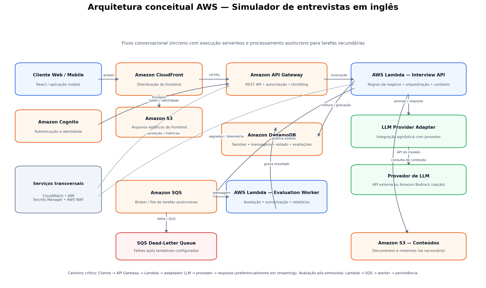

# Proposta de arquitetura AWS — Simulador de entrevistas em inglês

> **Versão:** 1.0 — proposta AWS  
> **Data:** 20/11/2026  
> **Status:** proposta preliminar para avaliação e evolução para o DAS  
> **Escopo:** arquitetura AWS com provedor de LLM desacoplado, sem fixar previamente o modelo ou fornecedor de inteligência artificial.

## 1. Resumo executivo

A solução propõe uma aplicação de simulação de entrevistas em inglês baseada em LLM. O fluxo principal é conversacional e síncrono: o candidato envia uma resposta, a aplicação recupera o contexto necessário, solicita a geração ao provedor de LLM e transmite a resposta ao cliente.

A arquitetura utiliza a AWS como provedora de nuvem e prioriza:

- **Baixa latência percebida:** streaming da resposta sempre que suportado ponta a ponta.
- **Escalabilidade:** execução serverless com serviços gerenciados.
- **Controle de custos:** pagamento baseado em uso, controle de tokens e redução do contexto enviado ao modelo.
- **Desacoplamento:** integração com LLM por meio de Adapter Pattern.
- **Processamento assíncrono seletivo:** avaliação pós-entrevista e geração de relatórios por mensageria.
- **Evolução gradual:** possibilidade de introduzir RAG, voz e serviços independentes quando houver necessidade.

A recomendação é iniciar com um **monólito modular serverless**, sem distribuir prematuramente o sistema em vários microsserviços. A arquitetura pode evoluir conforme os requisitos de escala, disponibilidade e organização da equipe.

## 2. Diagrama conceitual AWS



O diagrama apresenta os principais componentes AWS e os fluxos de comunicação. O provedor de LLM permanece desacoplado: pode ser um serviço externo consumido por API ou, caso faça sentido em uma evolução, o Amazon Bedrock.

## 3. Componentes AWS e responsabilidades

| Camada | Serviço AWS | Responsabilidade |
|---|---|---|
| Distribuição do frontend | Amazon CloudFront | Distribuir conteúdo estático com baixa latência |
| Hospedagem do frontend | Amazon S3 | Armazenar arquivos estáticos da aplicação web |
| Identidade | Amazon Cognito | Autenticar usuários e fornecer tokens de identidade |
| Entrada da API | Amazon API Gateway | Expor endpoints, validar autorização e aplicar throttling |
| Execução principal | AWS Lambda | Executar regras de negócio e orquestrar a entrevista |
| Persistência | Amazon DynamoDB | Armazenar sessões, mensagens, estado e avaliações |
| Mensageria | Amazon SQS | Enfileirar tarefas assíncronas |
| Processamento assíncrono | AWS Lambda | Executar avaliações e gerar relatórios em segundo plano |
| Armazenamento de objetos | Amazon S3 | Guardar documentos, materiais e artefatos |
| Segredos | AWS Secrets Manager | Guardar credenciais e chaves de APIs externas |
| Observabilidade | Amazon CloudWatch | Centralizar logs, métricas e alarmes |
| Permissões | AWS IAM | Aplicar políticas de menor privilégio |
| Proteção da aplicação | AWS WAF | Proteger endpoints e recursos web contra tráfego malicioso, conforme configuração |

**Provedor de LLM:** permanece como dependência externa abstrata. A aplicação conversa com ele por meio de um adaptador. Amazon Bedrock é uma alternativa possível, mas não uma dependência obrigatória desta proposta.

## 4. Fluxo síncrono de conversação

O fluxo principal deve priorizar uma resposta rápida ao candidato.

1. O usuário acessa a aplicação web distribuída pelo CloudFront, com os arquivos estáticos hospedados no S3.
2. O usuário autentica-se por meio do Amazon Cognito, quando a aplicação exigir contas.
3. O frontend envia uma mensagem por HTTPS ao Amazon API Gateway.
4. O API Gateway aplica as configurações de autorização, throttling e roteamento.
5. A AWS Lambda — Interview API valida a entrada e identifica a entrevista.
6. A função recupera no DynamoDB o estado da sessão, o histórico relevante e o resumo contextual.
7. O módulo de construção de prompt prepara as instruções e o contexto.
8. O LLM Provider Adapter chama o provedor de LLM escolhido.
9. A resposta é encaminhada ao frontend, preferencialmente de forma progressiva por streaming.
10. A aplicação registra as mensagens e atualiza o estado da entrevista no DynamoDB.

### 4.1 Exemplo de endpoint

```http
POST /api/v1/interviews/{interview_id}/messages
Content-Type: application/json
Authorization: Bearer <token>
```

Exemplo de corpo:

```json
{
  "message": "I have experience with Python and AWS.",
  "language": "en"
}
```

Exemplo simplificado de resposta:

```json
{
  "interview_id": "12345",
  "message": "Can you explain how you used AWS?",
  "status": "in_progress"
}
```

O contrato definitivo deve incluir identificadores de mensagem, timestamps, códigos de erro e metadados de consumo, quando disponíveis.

## 5. Streaming e latência

Para manter a naturalidade da entrevista, recomenda-se transmitir a resposta à medida que o provedor de LLM gera o conteúdo.

**Server-Sent Events (SSE)** ou HTTP response streaming são alternativas para enviar fragmentos de resposta ao navegador. WebSocket pode ser avaliado futuramente se houver necessidade de comunicação bidirecional contínua, especialmente para voz.

Na AWS, o desenho deve validar cuidadosamente o caminho de streaming. Uma possibilidade é utilizar **Amazon API Gateway REST API com resposta em modo streaming**, integrado a uma implementação Lambda compatível. Os limites e requisitos de integração devem ser confirmados na documentação vigente antes da implementação. Não se deve presumir que qualquer tipo de API Gateway, integração Lambda ou configuração HTTP suporte streaming da mesma maneira.

Se a combinação API Gateway + Lambda não atender ao padrão de conexão, duração ou streaming necessário, alternativas incluem:
- uma camada de aplicação em containers no Amazon ECS com AWS Fargate;
- API Gateway WebSocket para comunicação bidirecional;
- outro desenho de streaming compatível com os requisitos de experiência.

Métricas importantes:
- Time to First Token (TTFT);
- tempo até o último token;
- latência total do turno;
- latência da chamada ao provedor;
- taxa de timeout e erro;
- tokens de entrada e saída.

O streaming melhora a latência percebida, mas não necessariamente reduz o tempo total de geração do modelo.

## 6. Persistência com Amazon DynamoDB

O DynamoDB é uma opção inicial para armazenar sessões e mensagens, especialmente quando os padrões de acesso são conhecidos e as consultas são orientadas por identificadores.

Modelo lógico inicial:

### InterviewSessions

| Campo | Descrição |
|---|---|
| session_id | Identificador da entrevista |
| user_id | Identificador do usuário |
| status | Estado da entrevista |
| job_position | Cargo ou função simulada |
| created_at | Data de criação |
| updated_at | Data da última atualização |
| context_summary | Resumo contextual da conversa |

### InterviewMessages

| Campo | Descrição |
|---|---|
| message_id | Identificador da mensagem |
| session_id | Identificador da entrevista |
| role | Candidate ou Interviewer |
| content | Conteúdo da mensagem |
| created_at | Data da mensagem |
| tokens_used | Consumo de tokens, quando disponível |

A modelagem física deve ser orientada pelos padrões de consulta. Pode-se utilizar uma tabela por entidade ou uma tabela única com chaves compostas. A decisão deve considerar paginação, ordenação cronológica, consultas por usuário e custo.

Para controlar custo e latência, não se deve enviar indefinidamente todo o histórico à LLM. Recomenda-se manter uma janela de mensagens recentes e um resumo contextual atualizado periodicamente.

## 7. Processamento assíncrono com Amazon SQS

A conversação permanece síncrona. Atividades que não precisam bloquear a resposta ao candidato são encaminhadas para o Amazon SQS.

Exemplos:
- avaliação gramatical;
- análise de vocabulário;
- avaliação por competências;
- sumarização final;
- geração de relatório;
- recomendações de estudo.

Fluxo:

1. O candidato finaliza a entrevista.
2. A Interview API registra o estado de finalização.
3. A aplicação publica uma mensagem no Amazon SQS.
4. Uma Lambda de avaliação consome a mensagem.
5. O worker recupera o histórico e solicita a análise ao provedor de LLM.
6. O resultado é persistido no DynamoDB.
7. O frontend consulta o resultado ou recebe uma notificação por mecanismo complementar.

Recomenda-se configurar uma **Dead Letter Queue (DLQ)** para mensagens que falharem repetidamente.

O consumidor deve ser idempotente, pois o processamento de mensagens pode ocorrer mais de uma vez. Um identificador único de tarefa e um estado de processamento ajudam a evitar avaliações duplicadas.

## 8. Integração agnóstica com LLM

A aplicação deve depender de uma interface interna, e não diretamente da API de um fornecedor.

Exemplo conceitual:

```python
from abc import ABC, abstractmethod

class LLMProvider(ABC):

    @abstractmethod
    def generate_response(self, messages):
        pass
```

Uma implementação concreta traduz o contrato interno para o protocolo e formato exigidos pelo provedor selecionado.

Essa abstração permite:
- substituir o provedor;
- comparar modelos;
- aplicar políticas diferentes por tipo de tarefa;
- centralizar timeout, retry e tratamento de erros;
- testar os casos de uso sem depender de chamadas reais ao modelo.

**Amazon Bedrock:** pode ser adotado como provedor de modelos dentro do ecossistema AWS, mas deve permanecer uma decisão de implementação. Caso seja escolhido um provedor externo, a comunicação ocorre por HTTPS e suas credenciais devem ser guardadas no Secrets Manager.

## 9. Segurança

Controles recomendados:

- Amazon Cognito para autenticação, se houver usuários cadastrados.
- IAM com privilégio mínimo para cada função e serviço.
- AWS Secrets Manager para chaves de API e credenciais.
- HTTPS para comunicação externa.
- Criptografia em repouso nos serviços de armazenamento.
- AWS WAF para proteção da camada web/API, conforme o desenho de exposição.
- Validação de entrada e limite de tamanho de mensagens.
- Rate limiting e quotas por usuário.
- Redação de dados sensíveis em logs.
- Políticas de retenção e exclusão de conversas.
- Isolamento dos dados por usuário e autorização em todas as consultas.

Também é necessário tratar prompt injection e conteúdo não confiável, especialmente se houver RAG ou documentos enviados pelos usuários.

## 10. Observabilidade

Amazon CloudWatch pode centralizar logs, métricas e alarmes.

Métricas recomendadas:

| Métrica | Objetivo |
|---|---|
| Requisições por minuto | Medir volume de uso |
| Taxa de erro da API | Identificar falhas |
| Duração da Lambda | Medir processamento interno |
| Concorrência da Lambda | Acompanhar pressão de capacidade |
| Latência do provedor LLM | Identificar gargalos externos |
| TTFT | Medir rapidez do primeiro fragmento |
| Latência total | Medir duração da interação |
| Tokens de entrada/saída | Controlar consumo |
| Mensagens na fila | Acompanhar tarefas pendentes |
| Idade da mensagem mais antiga | Identificar atraso do worker |
| Custo por entrevista | Acompanhar custo unitário |

Utilizar `request_id` e `interview_id` como identificadores de correlação, evitando registrar conteúdo sensível desnecessário.

## 11. Escalabilidade e resiliência

A combinação de API Gateway, Lambda, DynamoDB e SQS oferece serviços gerenciados que reduzem a necessidade de administrar servidores. Entretanto, a capacidade efetiva depende das quotas e limites de cada serviço e do provedor de LLM.

Controles:
- configurar concorrência e throttling;
- aplicar limites por usuário;
- controlar o volume de chamadas ao provedor;
- estabelecer timeout explícito;
- aplicar retry com backoff exponencial e jitter apenas em falhas transitórias;
- evitar repetir chamadas de geração sem controle;
- implementar idempotência;
- utilizar DLQ para tarefas assíncronas;
- configurar alarmes para erros, throttling e acúmulo de mensagens.

A AWS Lambda é a opção inicial para a API e os workers devido à simplicidade operacional. **Amazon ECS com AWS Fargate** deve ser avaliado se surgirem requisitos de conexões persistentes, sessões de voz contínuas, execução prolongada ou controle maior do runtime.

## 12. Custos e otimização

Principais fontes de custo:
- requisições e transferência na camada de API;
- duração e quantidade de invocações Lambda;
- leituras e gravações no DynamoDB;
- mensagens processadas no SQS;
- armazenamento no S3;
- logs e métricas no CloudWatch;
- consumo do provedor LLM.

O custo do modelo pode ser uma das maiores parcelas. Estratégias:
- limitar tokens de entrada e saída;
- controlar o histórico enviado;
- resumir conversas longas;
- selecionar modelos de menor custo para tarefas simples;
- evitar avaliações duplicadas;
- acompanhar custo por entrevista;
- definir orçamento e alarmes de consumo.

## 13. Roadmap

### Fase 1 — MVP
- CloudFront e S3 para frontend web, se aplicável;
- Cognito para autenticação, se necessário;
- API Gateway;
- Lambda para API principal;
- DynamoDB;
- integração via adapter com um provedor LLM;
- Secrets Manager;
- CloudWatch;
- streaming, após validar compatibilidade ponta a ponta.

### Fase 2 — Avaliação assíncrona
- SQS;
- Lambda Evaluation Worker;
- DLQ;
- idempotência;
- avaliação estruturada;
- geração de relatórios;
- métricas de custo e qualidade.

### Fase 3 — Personalização
- RAG com serviços de armazenamento e busca apropriados;
- múltiplos provedores de LLM;
- análise histórica de desempenho;
- recomendações de estudo;
- voz e transcrição, caso entrem no escopo.

## 14. Decisões arquiteturais

| Dimensão | Escolha proposta | Justificativa |
|---|---|---|
| Cloud provider | AWS | Plataforma de nuvem definida para a solução |
| Estilo arquitetural | Monólito modular serverless | Simplicidade e evolução incremental |
| Backend | Linguagem a definir; Python é uma opção | Ecossistema de integração com IA |
| API | Amazon API Gateway | Exposição, autorização e throttling |
| Compute | AWS Lambda | Execução sob demanda |
| Persistência | Amazon DynamoDB | Banco gerenciado e escalável |
| Mensageria | Amazon SQS | Processamento assíncrono |
| Worker | AWS Lambda | Consumo de tarefas |
| Frontend estático | Amazon S3 + CloudFront | Hospedagem e distribuição |
| Identidade | Amazon Cognito | Autenticação gerenciada |
| LLM | Provedor agnóstico via adapter | Evitar dependência de fornecedor |
| Segredos | AWS Secrets Manager | Proteção de credenciais |
| Observabilidade | Amazon CloudWatch | Logs, métricas e alarmes |
| Segurança | IAM, WAF, Cognito e validação | Controle de acesso e proteção |

## 15. Riscos e pontos de validação

1. **Streaming:** validar API Gateway REST response streaming, integração Lambda e limites vigentes. Não assumir suporte uniforme entre modalidades de API.
2. **Latência:** medir TTFT e latência total com o provedor e região escolhidos.
3. **Cotas:** verificar limites de concorrência, throttling, DynamoDB e SQS.
4. **LLM:** validar quotas, preço, privacidade, qualidade e disponibilidade do provedor.
5. **Persistência:** testar padrões de consulta e paginação no DynamoDB.
6. **Idempotência:** testar reenvios, falhas parciais e mensagens duplicadas.
7. **Custos:** calcular custo médio por entrevista com tráfego representativo.
8. **Privacidade:** definir retenção e exclusão dos dados.
9. **Voz:** se for requisito, avaliar separadamente streaming bidirecional e serviços de áudio.

## 16. Referências oficiais para aprofundamento

- [AWS Lambda — Developer Guide](https://docs.aws.amazon.com/lambda/latest/dg/welcome.html)
- [Amazon API Gateway — Developer Guide](https://docs.aws.amazon.com/apigateway/latest/developerguide/welcome.html)
- [Amazon API Gateway — Response streaming](https://docs.aws.amazon.com/apigateway/latest/developerguide/response-transfer-mode.html)
- [Amazon DynamoDB — Developer Guide](https://docs.aws.amazon.com/amazondynamodb/latest/developerguide/Introduction.html)
- [Amazon SQS — Developer Guide](https://docs.aws.amazon.com/AWSSimpleQueueService/latest/SQSDeveloperGuide/welcome.html)
- [Amazon SQS — Dead-letter queues](https://docs.aws.amazon.com/AWSSimpleQueueService/latest/SQSDeveloperGuide/sqs-dead-letter-queues.html)
- [Amazon Cognito — Developer Guide](https://docs.aws.amazon.com/cognito/latest/developerguide/what-is-amazon-cognito.html)
- [AWS Secrets Manager — User Guide](https://docs.aws.amazon.com/secretsmanager/latest/userguide/intro.html)
- [Amazon CloudWatch — User Guide](https://docs.aws.amazon.com/AmazonCloudWatch/latest/monitoring/WhatIsCloudWatch.html)
- [Amazon ECS with AWS Fargate](https://docs.aws.amazon.com/AmazonECS/latest/developerguide/AWS_Fargate.html)
- [Amazon Bedrock — User Guide](https://docs.aws.amazon.com/bedrock/latest/userguide/what-is-bedrock.html)
- [AWS Well-Architected Framework](https://docs.aws.amazon.com/wellarchitected/latest/framework/welcome.html)

## 17. Conclusão

A proposta AWS utiliza API Gateway, Lambda e DynamoDB no caminho conversacional síncrono, com streaming para reduzir a latência percebida quando suportado ponta a ponta. O processamento de avaliações e relatórios ocorre fora do caminho crítico por meio de SQS e uma função Lambda consumidora.

O provedor de LLM permanece agnóstico, acessado por um adaptador. Isso permite utilizar um serviço externo ou avaliar Amazon Bedrock sem alterar as regras centrais da aplicação.

A arquitetura busca equilibrar simplicidade, escalabilidade e custo. A decisão por serviços adicionais, RAG, voz ou microsserviços deve ser orientada por requisitos e testes, evitando complexidade prematura.

---

## Apêndice — perguntas para fechar o DAS

- A aplicação será exclusivamente web ou também mobile?
- A interação será apenas textual ou incluirá voz?
- Qual é o volume esperado de usuários e entrevistas simultâneas?
- Qual é a duração média de uma entrevista?
- Qual é a meta de TTFT e latência total?
- Qual provedor/modelo LLM atende aos requisitos de qualidade, custo e privacidade?
- O streaming será SSE, HTTP response streaming ou WebSocket?
- Quais dados serão mantidos e por quanto tempo?
- Quais critérios compõem a avaliação do candidato?
- Existe uma base de conhecimento própria que justifique RAG?

As respostas devem orientar o detalhamento dos requisitos não funcionais, os testes de carga, os diagramas de implantação e os ADRs.
