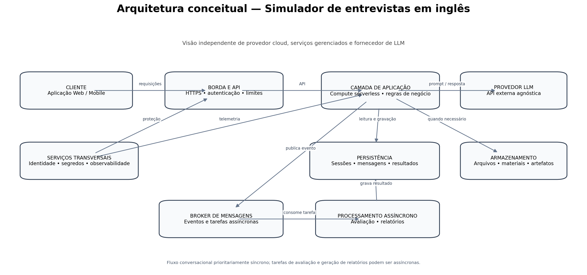
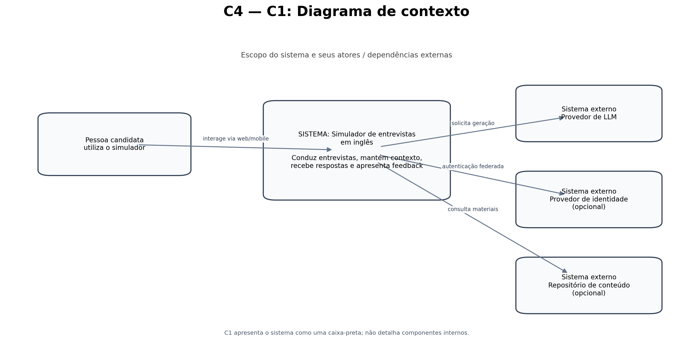
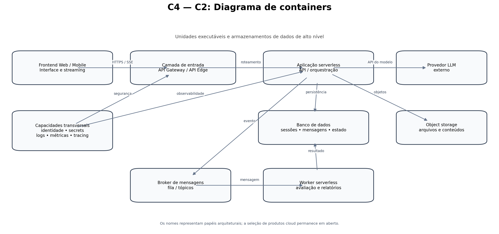
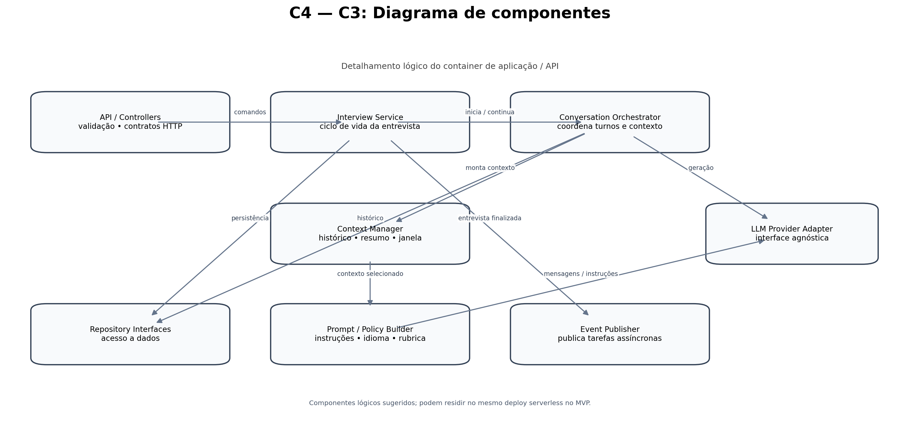
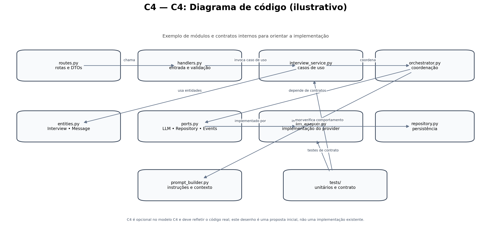

# Proposta de arquitetura conceitual — Simulador de entrevistas em inglês

> **Versão:** 1.0 — proposta inicial  
> **Data:** 20/11/2026  
> **Objetivo:** consolidar uma arquitetura cloud-native, escalável e de complexidade operacional moderada, sem fixar previamente fornecedor de nuvem, produtos específicos ou provedor de LLM.

## 1. Resumo executivo

A solução propõe uma aplicação de simulação de entrevistas em inglês baseada em LLM. O fluxo principal é conversacional e síncrono: o candidato envia uma resposta, a aplicação recupera o contexto necessário, solicita a geração ao provedor de LLM e transmite a resposta ao cliente.

A arquitetura prioriza:
- **Baixa latência percebida**, utilizando streaming de resposta sempre que suportado pelo caminho completo.
- **Escalabilidade horizontal**, com uma camada de execução serverless gerenciada pelo provedor cloud.
- **Controle de custos**, evitando infraestrutura permanentemente provisionada e controlando tokens, histórico e retenção.
- **Desacoplamento**, por meio de adaptadores para LLM, abstrações de persistência e broker.
- **Processamento assíncrono seletivo**, reservado a tarefas que não precisam bloquear a conversa, como avaliação final e geração de relatórios.

A proposta não exige microsserviços distribuídos no primeiro momento. Recomenda-se um monólito modular implantado em compute serverless, com possibilidade de extrair serviços quando houver evidência operacional ou organizacional para isso.

## 2. Princípios e decisões de arquitetura

1. **Cloud-agnostic no nível conceitual:** os diagramas descrevem capacidades (API edge, compute serverless, banco, object storage, broker, observabilidade), não produtos específicos.
2. **LLM-agnostic:** a aplicação acessa o modelo por uma interface/adaptador. O provedor pode ser substituído sem alterar as regras centrais.
3. **Síncrono no caminho crítico:** a interação do candidato não deve depender de uma fila para obter a próxima resposta.
4. **Assíncrono fora do caminho crítico:** avaliações completas, relatórios e tarefas demoradas podem ser publicadas em um broker e processadas por workers.
5. **Persistência explícita:** sessões, mensagens e resultados devem ter modelos e políticas de retenção definidos.
6. **Observabilidade desde o início:** medir latência ponta a ponta, time-to-first-token, erros, tokens e custo por entrevista.
7. **Evolução incremental:** introduzir RAG, múltiplos provedores e microsserviços somente quando houver necessidade demonstrável.

## 3. Diagrama conceitual geral

### 3.1 Componentes

| Componente conceitual | Responsabilidade |
|---|---|
| Cliente Web / Mobile | Interface de entrevista, captura de respostas e apresentação progressiva da resposta |
| Borda / API | Exposição HTTPS, roteamento, autenticação/autorização, quotas e proteção contra abuso |
| Aplicação serverless | Regras de negócio, orquestração da entrevista, gestão do contexto e integração com dependências |
| Adaptador de LLM | Contrato interno independente do fornecedor e tradução de requisições/respostas |
| Provedor de LLM | Geração de perguntas, comentários e feedback conversacional |
| Persistência | Armazenar sessões, mensagens, estado, resumos e avaliações |
| Broker | Desacoplar tarefas que podem ser executadas posteriormente |
| Worker assíncrono | Processar avaliações, relatórios e outras tarefas fora do caminho crítico |
| Object storage | Armazenar documentos de referência, arquivos e artefatos, se necessários |
| Capacidades transversais | Identidade, gestão de segredos, logs, métricas, tracing e políticas de segurança |

### 3.2 Fluxo síncrono principal

1. O candidato envia uma mensagem pela aplicação cliente.
2. A borda/API autentica e encaminha a solicitação.
3. A aplicação serverless valida a requisição e identifica a sessão.
4. O gerenciador de contexto recupera as mensagens relevantes e o resumo da entrevista.
5. O construtor de prompts prepara as instruções, o contexto e a mensagem atual.
6. O adaptador encaminha a solicitação ao provedor de LLM.
7. A resposta é transmitida progressivamente ao cliente, quando o provedor e a infraestrutura suportarem streaming.
8. A aplicação persiste a interação e atualiza o estado da sessão.

**Observação de implementação:** definir cuidadosamente a ordem entre persistência e envio de eventos, para evitar respostas exibidas ao usuário sem registro durável. Também é necessário definir como tratar interrupções, reenvios e respostas parciais.

### 3.3 Fluxo assíncrono secundário

1. A entrevista é finalizada.
2. A aplicação publica um evento ou comando no broker.
3. Um worker consome a mensagem e executa avaliação, sumarização ou geração de relatório.
4. O resultado é persistido.
5. O cliente consulta o estado ou recebe uma notificação por mecanismo apropriado.

O broker não deve ser inserido no fluxo de cada turno conversacional sem uma justificativa específica, pois isso adicionaria latência e complexidade.

## 4. Protocolos e comunicação

| Comunicação | Uso proposto |
|---|---|
| HTTPS / REST | Criar, consultar, atualizar e finalizar entrevistas; operações administrativas |
| SSE ou HTTP streaming | Entregar tokens/fragmentos da resposta progressivamente ao navegador |
| WebSocket | Alternativa se futuramente houver comunicação bidirecional contínua, por exemplo voz em tempo real |
| Mensageria assíncrona | Despachar avaliação e tarefas secundárias para workers |
| API do provedor LLM | Comunicação entre adaptador e modelo externo |

SSE é uma opção simples quando o servidor precisa transmitir atualizações em uma direção. WebSocket pode ser avaliado se a experiência evoluir para áudio bidirecional, interrupções e eventos em tempo real. A decisão deve considerar suporte real do provedor, plataforma de execução, limites de conexão, timeouts e custo.

## 5. C4 — Diagramas por nível

O modelo C4 possui quatro níveis usuais: Contexto (C1), Containers (C2), Componentes (C3) e Código (C4). O nível C4 é opcional e normalmente é detalhado apenas quando ajuda a explicar a estrutura interna de implementação.

### 5.1 C1 — Contexto

O diagrama de contexto representa o sistema como uma única unidade e mostra quem o utiliza e quais sistemas externos são necessários.

**Atores e dependências:**
- Pessoa candidata: utiliza o simulador para praticar entrevistas.
- Simulador: conduz a entrevista, mantém contexto e apresenta feedback.
- Provedor de LLM: recebe contexto e instruções e retorna conteúdo gerado.
- Provedor de identidade: dependência opcional para autenticação.
- Repositório de conteúdo: dependência opcional para materiais e critérios de entrevista.

### 5.2 C2 — Containers

O nível de containers mostra as principais unidades executáveis e os armazenamentos de dados.

| Container | Responsabilidade |
|---|---|
| Frontend Web / Mobile | Interface e apresentação de streaming |
| Camada de entrada | API, autenticação, roteamento e proteção |
| Aplicação serverless | Casos de uso e orquestração conversacional |
| Banco de dados | Sessões, mensagens, estado e avaliações |
| Broker | Mensagens e tarefas assíncronas |
| Worker serverless | Avaliações e relatórios |
| Object storage | Arquivos e materiais |
| Serviços transversais | Identidade, segredos e observabilidade |

Os containers são fronteiras lógicas. A aplicação e o worker podem compartilhar código ou módulos, mesmo que sejam implantados separadamente.

### 5.3 C3 — Componentes

O nível de componentes detalha a aplicação serverless/API.

- **API / Controllers:** recebe requisições, valida contratos e converte entradas em comandos.
- **Interview Service:** controla início, continuidade e finalização da entrevista.
- **Conversation Orchestrator:** coordena o turno conversacional e as dependências.
- **Context Manager:** seleciona histórico, resumo e limite de contexto.
- **Prompt / Policy Builder:** compõe instruções, idioma, perfil da vaga e rubricas.
- **LLM Provider Adapter:** isola o contrato específico do fornecedor.
- **Repository Interfaces:** abstrai leitura e escrita de sessões e mensagens.
- **Event Publisher:** publica tarefas que devem ser processadas de forma assíncrona.

### 5.4 C4 — Código (visão ilustrativa)

O nível de código é uma decomposição ilustrativa, não uma descrição de código já implementado. Deve ser atualizado quando a linguagem, framework e estrutura real forem escolhidos.

| Módulo ilustrativo | Papel |
|---|---|
| `routes.py` | Definição de rotas e contratos HTTP |
| `handlers.py` | Entrada, validação e tradução de requisições |
| `interview_service.py` | Casos de uso e regras da entrevista |
| `orchestrator.py` | Coordenação do turno conversacional |
| `entities.py` | Entidades de domínio, como Interview e Message |
| `ports.py` | Contratos para LLM, repositório e eventos |
| `llm_adapter.py` | Implementação do contrato para um provedor específico |
| `repository.py` | Implementação de persistência |
| `prompt_builder.py` | Construção de prompts e contexto |
| `tests/` | Testes unitários, integração e contrato |

## 6. Estratégia de latência e desempenho

A latência percebida depende principalmente do tempo de resposta do provedor LLM, do tamanho do contexto, da rede e dos componentes intermediários. A execução serverless não elimina esses fatores.

Métricas recomendadas:
- **Time to First Token (TTFT):** tempo até o primeiro fragmento chegar ao cliente.
- **Time to Last Token:** tempo até a conclusão da resposta.
- **End-to-end latency:** duração total do turno.
- **Provider latency:** duração observada na chamada ao LLM.
- **Token throughput:** velocidade de geração, quando disponível.
- **Erro e timeout por dependência:** taxa de falhas da API, banco e provedor.

Técnicas:
- streaming ponta a ponta;
- prompts concisos e contexto limitado;
- resumo periódico da conversa;
- limites de tokens de entrada e saída;
- reutilização de conexões quando suportada pelo runtime;
- timeouts explícitos e tratamento de cancelamento;
- evitar chamadas redundantes ao modelo.

## 7. Escalabilidade e resiliência

A camada serverless pode escalar horizontalmente conforme a demanda, sujeita às quotas e limites do provedor cloud. A capacidade do banco, broker e provedor LLM também precisa ser dimensionada.

Controles recomendados:
- limites de concorrência e quotas;
- rate limiting por usuário e sessão;
- backpressure quando o provedor estiver saturado;
- timeout por chamada;
- retry com backoff exponencial apenas para falhas transitórias e operações seguras para repetição;
- circuit breaker ou mecanismo equivalente para falhas persistentes;
- idempotência para comandos e consumo de mensagens;
- dead-letter queue para mensagens que excederem as tentativas;
- limites de tamanho de mensagem e duração de entrevista.

Mensagens em broker devem ser tratadas como entregues pelo menos uma vez, salvo garantia explícita diferente da tecnologia escolhida. O worker deve ser idempotente.

## 8. Persistência e gestão de contexto

Modelo lógico inicial:
- **Interview:** identificador, usuário, estado, perfil/cargo, timestamps e resumo.
- **Message:** identificador, entrevista, papel (candidate/interviewer), conteúdo, timestamp e metadados de uso.
- **Evaluation:** identificador, entrevista, critérios, resultado, versão do avaliador e estado do processamento.

A tecnologia de banco deve ser escolhida após avaliar padrões de consulta, consistência, consultas analíticas, relacionamentos, custo e familiaridade da equipe. Um banco relacional gerenciado ou um banco NoSQL gerenciado podem ser adequados; o diagrama não fixa essa escolha.

Não enviar indefinidamente todo o histórico à LLM. Aplicar janela contextual, sumarização e políticas de retenção. Definir também exclusão de dados, exportação e consentimento conforme os requisitos de privacidade.

## 9. RAG e base de conhecimento

RAG não é requisito obrigatório para a primeira versão. Ele passa a ser relevante quando o simulador precisa fundamentar a entrevista em conteúdo próprio, como:
- descrições de vagas;
- banco curado de perguntas;
- rubricas de avaliação;
- guias de competências;
- materiais didáticos.

Uma solução futura pode ingerir documentos no object storage, gerar embeddings, indexar vetores e recuperar trechos relevantes antes da chamada ao LLM. A base vetorial e o mecanismo de embeddings devem permanecer decisões em aberto até haver requisitos claros de busca, volume e atualização.

## 10. Segurança e privacidade

- Nunca expor chaves do provedor LLM no frontend.
- Armazenar credenciais em serviço de gestão de segredos.
- Aplicar menor privilégio às identidades de execução.
- Proteger tráfego em trânsito e dados em repouso.
- Validar entradas e limitar tamanho de prompts.
- Aplicar autenticação, autorização, quotas e proteção contra abuso.
- Redigir ou mascarar dados pessoais nos logs.
- Definir retenção, exclusão e acesso aos históricos.
- Tratar conteúdo fornecido pelo usuário e recuperado via RAG como dado não confiável.
- Considerar prompt injection, vazamento de dados, uso indevido do modelo e custos abusivos.

## 11. Custos

Principais dimensões de custo:
1. Execução serverless e camada de API.
2. Armazenamento, leituras e gravações.
3. Mensageria e execução dos workers.
4. Logs, métricas e tracing.
5. Armazenamento de documentos.
6. Consumo do provedor LLM, normalmente uma das maiores variáveis.

Indicadores:
- custo médio por entrevista;
- tokens de entrada e saída por turno;
- custo por usuário ativo;
- duração média das entrevistas;
- taxa de reprocessamento;
- armazenamento por sessão e política de retenção.

O controle mais importante tende a ser o consumo de tokens: limitar contexto, controlar saída máxima, selecionar modelos por complexidade e evitar avaliações duplicadas.

## 12. Decisões em aberto e critérios de validação

| Decisão | Critério para decidir |
|---|---|
| Provedor cloud | Custo total, serviços gerenciados, região, conformidade e experiência da equipe |
| Tecnologia serverless | Suporte a streaming, duração máxima, concorrência, cold start e custo |
| Banco de dados | Padrões de acesso, consistência, consultas e volume |
| Broker | Garantias de entrega, ordenação, DLQ, throughput e custo |
| SSE ou WebSocket | Necessidade de comunicação unidirecional ou bidirecional contínua |
| Provedor LLM | Qualidade, latência, preço, limites, streaming e privacidade |
| RAG | Existência de corpus próprio e necessidade de recuperação contextual |
| Monólito modular ou serviços separados | Necessidade de deploy, escala e ownership independentes |

Antes de fechar a arquitetura, realizar um teste de carga representativo e medir TTFT, latência total, concorrência, erros, consumo de tokens e custo por entrevista.

## 13. Roadmap sugerido

### Fase 1 — MVP
- Frontend e API.
- Compute serverless.
- Adaptador para um provedor LLM.
- Persistência de sessão e mensagens.
- Streaming, se suportado ponta a ponta.
- Logs, métricas básicas e limites de uso.

### Fase 2 — Avaliação assíncrona
- Broker.
- Worker para avaliação e relatório.
- Estado de processamento e consulta de resultados.
- Idempotência, retry e DLQ.
- Métricas de custo e qualidade.

### Fase 3 — Personalização
- RAG e base de conhecimento.
- Mais de um provedor LLM.
- Avaliação por rubricas e evolução histórica.
- Recursos de voz em tempo real, caso façam parte do escopo.

## 14. Conclusão

A proposta recomendada é uma arquitetura cloud-native com execução serverless, fluxo conversacional síncrono e streaming, persistência gerenciada e processamento assíncrono por broker para tarefas secundárias. A aplicação deve ser modular e independente do provedor de LLM. A escolha de produtos específicos de nuvem fica para uma etapa posterior, baseada em requisitos, testes e análise de custo.

Essa abordagem atende ao objetivo de validar o conceito sem assumir a complexidade de uma arquitetura de microsserviços completa. Ao mesmo tempo, cria pontos claros de evolução para escala, RAG, voz e análise de desempenho.

## 15. Como utilizar este material

- Os PNGs podem ser inseridos diretamente no documento acadêmico.
- O Markdown mantém os diagramas incorporados por caminhos relativos; mantenha os arquivos PNG na mesma pasta do `.md`.
- O C4 C1–C3 descreve a arquitetura em níveis progressivos. O C4 de código é ilustrativo e deve ser ajustado à implementação efetiva.
- Substitua os nomes conceituais por produtos específicos somente após comparar alternativas e registrar a justificativa em decisões arquiteturais (ADRs).
